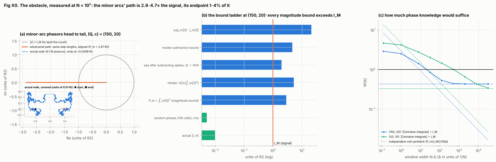
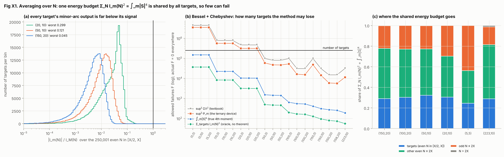
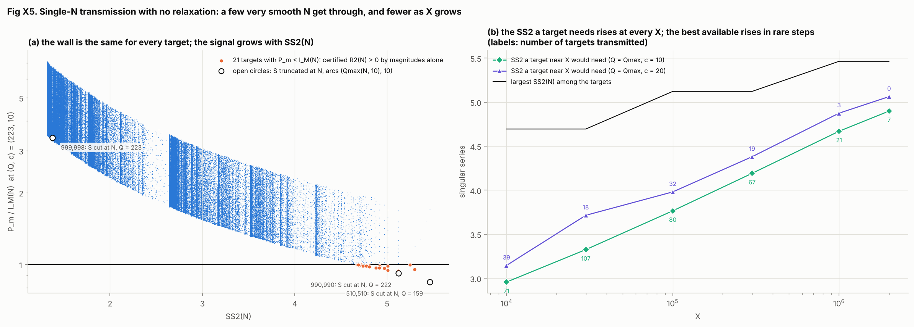
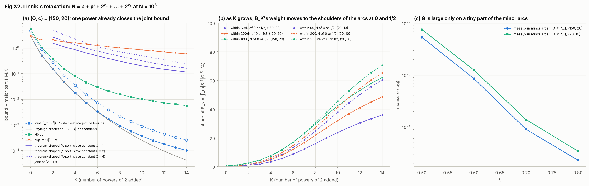
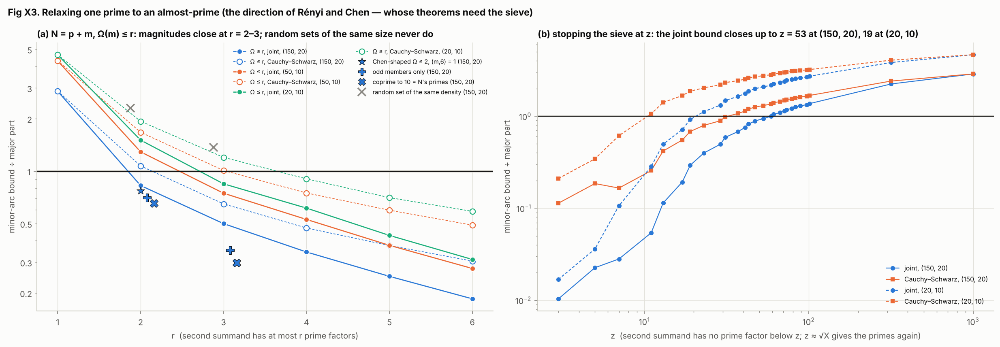
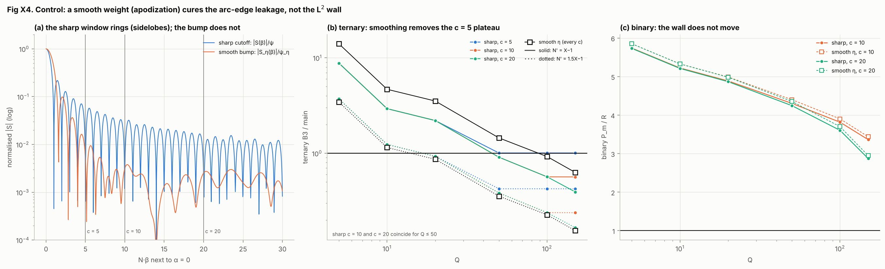

# Relaxations under which the magnitude inequality closes at N = 10^6

> Exploration at one finite X, not a proof and not an attempt at one. Every number below is a floating-point
> computation on the grid M = 2^23 at X = N = 10^6 (plus the scaling runs); none is a theorem, and none of the
> experiments gets past the binary wall for a single typical N. Each one changes the question.

At N = 10^6 the magnitude-only bound fails for every tabulated (Q,c) (P_m/R2 = 2.62–5.76, results.md).
Proving R2(N) > 0 for every large N this way would require showing that the minor-arc phases cancel uniformly in N; that
is the open problem. For a single N, R2(N) > 0 is a finite check (done to 4·10^18). This file does two things: it
measures the obstacle for one N (E0), and it tests, at the same X, the relaxations under which the circle method's
*magnitude* inequality does close — averaging over N (E1), adding powers of 2 (E2), relaxing one prime to an almost-prime
(E3) — plus the targets that get through with no relaxation (E5) and a control that should not help (E4).

**What "closes" means.** For a target N and arcs M(Q,c) (half-width c/N, exact integer membership, as in results.md),
R(N) = I_M + I_m. A bound on |I_m| that uses magnitudes only is computed and divided by I_M. Because the arc integrals
are Riemann sums, each ratio carries a decision margin: **closes** < 0.99, **undecided** 0.99–1.01, **fails** > 1.01.
"Closes" means the method's inequality alone gives R(N) > 0 for that target, numerically, at this X. Every K\*, r\* and
z\* below is a finite-X statistic of this computation, not comparable to a constant in a theorem.

## Headline

| experiment | question | key numbers | verdict at X = 10^6 | literature direction |
|:---|:---|:---|:---|:---|
| E0 obstacle | how far is the binary wall from closing, for one N? | P_m/I_M = 2.90 at (150,20); best refinement 3.3·I_M | fails at every (Q,c); window phases over ≈ 20/N would suffice | the open problem |
| E1 average over N | how many of the 250,001 even N in [X/2, X] can the inequality lose? | F ≤ 274 (true 4th moment), ≤ 5,935 (sup form); actual F = 0 | closes for all but ≤ 0.11% (sup form 2.4%) | van der Corput, Chudakov, Estermann 1937–38 |
| E5 transmission | does any single N get through with no relaxation? | 21 N at (223,10), best P_m/I_M(N) = 0.919 | closes for N with SS2 ≈ 5; fraction 2.8% at 10^4 → 0.0014% at 2·10^6 | finite checks to 4·10^18 |
| E2 Linnik | N = p + p′ + 2^(k₁) + … + 2^(k_K) | joint B_1/I_M,1 = 0.505; theorem-shaped K\* = 4 / 5 / 7 | closes at K = 1 (joint bound), generic averaging | Linnik 1951/53; best published K = 8 |
| E3 almost-primes | N = p + m with Ω(m) ≤ r | Ω ≤ 2: joint 0.828 at (150,20); random set of equal density 2.30 | closes at r = 2–4 depending on (Q,c) | Rényi 1948, Chen 1973 (sieve theorems) |
| E4 smooth weight | does smoothing move the wall? (control) | binary P_m/R_η = 2.67–5.85 | binary wall unchanged; ternary c = 5 plateau removed | standard practice |

## 0. Certificates

Every identity the experiments rely on, checked at full scale (M = 2^23 unless stated). The FFT sign convention is the one documented and checked in results.md.

| check | result |
|:---|:---|
| Bessel identity Σ_N I_m(N)² = ∫_m\|S\|⁴, all 20 pairs | max rel. error 4.7e-12 |
| full-circle 4th moment ∫\|S\|⁴ = Σ_N r2(N)² (additive energy) | 1.532122e18 vs 1.532122e18, rel. 0.0e0 |
| E0: walk endpoint = R2 − I_M; path length = E1's P_m | 7.0e-16·R2 (imag ≤ 2.6e-17·R2); 3.7e-16 |
| E1/E5: every transmitted N has r2(N) ≥ I_M(N) − P_m > 0 (20 pairs + 12 scaling runs) | all hold |
| E2: R_K grid = direct, K ≤ 14 (grid exact) | max rel. 1.1e-15, imag ≤ 3.1e-16 |
| E2: K = 15, 16 (past the exactness limit; the aliased tuples are negligible) | rel. 1.2e-15, 1.3e-15 |
| E3: R^(A)(X) grid = direct, all 40 sets | max rel. 4.3e-16, imag ≤ 1.7e-16 |
| E4: R_η(X) and R3_η(N') grid = direct (4 targets) | 1.3e-16; max 5.6e-16 |
| E4: R_η / main, R3_η / main | 0.99984; 0.99975, 1.00032, 1.00044, 1.00019 |

E5 single-N certificates recomputed with S truncated at N itself (P_m(S_N) < P_m(S_X), so the X = 10^6 arrays are conservative for N < X), arcs (Q_max(N, 10), 10):

| N | factorisation | M | (Q,c) | P_m / I_M(N) | verdict |
|---:|:---|:---|---:|---:|:---|
| 510,510 | 2·3·5·7·11·13·17 | 2^21 | (159,10) | 0.844 | closes |
| 990,990 | 2·3²·5·7·11²·13 | 2^22 | (222,10) | 0.918 | closes |
| 999,998 | 2·31·127² | 2^22 | (223,10) | 3.398 | fails |

Run: 4.1 min, peak RSS 1,412 MB.

## 1. E0 — the obstacle, measured

For one target N = X, the minor arcs add M·|m| phasors w_k = S(k/M)² e(−Nk/M)/M to the count. Laid head to tail they
form a walk F_j = Σ_(i≤j) w_(k_i): its **path length** is P_m = ∫_m|S|², its **endpoint** is I_m(N) = R2(N) − I_M(N).
A bound that knows only magnitudes must allow every step to point the same way, so it can never beat P_m.
Every column below is in units of R2(X) = 1,756,567.5 except the last four.

| (Q,c) | path P_m | max \|F\| | endpoint I_m | I_M | rms, 1/N cells | σ_rp = P_m/√(N\|m\|) | Hölder √(\|m\|∫_m\|S\|⁴) | sup_m\|S\|·∫_m\|S\| | sea after model, best | model bound / I_M | W(∞) (components) | Δ* |
|---:|---:|---:|---:|---:|---:|---:|---:|---:|:---|---:|---:|:---|
| (150,20) | 2.873 | 0.0138 | +0.0098 | 0.990 | 0.0051 | 0.0034 | 5.23 | 20.96 | 1.95 (Q' = 1414) | 3.31–4.69 | 0.431 (6,858) | ≈ 20/N |
| (20,10) | 4.886 | 0.0492 | -0.0444 | 1.044 | 0.0323 | 0.0049 | 37.77 | 164.76 | 2.66 (Q' = 1414) | 7.26–7.60 | 0.331 (128) | ≈ 517/N |

**Bound ladder at (150,20).** Every magnitude-only refinement we tried is at least as long as the path: Hölder is
1.82·P_m, sup × L¹ is 7.3·P_m. Subtracting a major-arc model S\* (spikes
(μ(q)/φ(q))·v(α − a/q) on disjoint windows of width 1/(qQ′), squarefree q ≤ Q′) and bounding the direction that
could spoil the count, −I_m ≤ P_E + 2√(P\*·P_E) − Re J\*, gives 3.31–4.69·I_M. The decoherent remainder
P_E = ∫_m|S − S\*|² bottoms out at 1.95·R2 near Q′ = 1414 and rises again beyond,
where the spikes are no longer resolved by windows of width 1/(qQ′). That remainder is not itself a bound; it is still
about twice the signal.

| Q′ | P_E / R2 | P\* / R2 | Re J\* / R2 | bound / I_M |
|---:|---:|---:|---:|---:|
| 150 | 2.858 | 0.016 | +0.005 | 3.31 |
| 300 | 2.470 | 0.404 | +0.005 | 4.51 |
| 500 | 2.221 | 0.653 | +0.005 | 4.67 |
| 707 | 2.090 | 0.786 | +0.005 | 4.69 |
| 1000 | 1.985 | 0.892 | +0.005 | 4.69 |
| 1414 | 1.949 | 0.929 | +0.005 | 4.68 |
| 2000 | 1.995 | 0.883 | +0.004 | 4.69 |
| 4000 | 2.208 | 0.668 | +0.004 | 4.68 |

**Partial-phase dial.** Cut each connected component of the minor arcs into windows of B grid points (width Δ = B/M,
N·Δ = B·X/M) and add |window integral| over all windows: W(B) = Σ|∫_window S²e(−Nα)| / I_M. B = 1 knows only magnitudes
(W = P_m/I_M); whole components know all the phase inside each gap between arcs.

| B | N·Δ | W at (150,20) | W at (20,10) |
|:---|:---|---:|---:|
| 1 | 0.12 | 2.901 | 4.679 |
| 8 | 0.95 | 2.534 | 4.199 |
| 64 | 7.63 | 1.430 | 2.782 |
| 256 | 30.52 | 0.857 | 2.019 |
| 1,024 | 122.07 | 0.531 | 1.460 |
| 4,096 | 488.28 | 0.444 | 1.018 |
| 16,384 | 1953.12 | 0.432 | 0.656 |
| 65,536 | 7812.50 | 0.431 | 0.431 |
| 262,144 | 31250.00 | 0.431 | 0.341 |
| whole components | ∞ | 0.431 | 0.331 |

W drops below 1 at N·Δ ≈ 20 at (150,20) and ≈ 517 at (20,10) (log–log interpolation between
the tabulated B). Independent cells would need only (P_m/I_M)² = 8.4. The rms of the cell sums at width 1/N is
1.5× the random-phase yardstick σ_rp at (150,20) and
6.6× at (20,10): cells of width 1/N are not independent, because the minor arcs
still contain unresolved spikes at a/q with q > Q, each coherent over about 1/N. At (20,10) those spikes (q = 21…) carry
coherent local integrals of size about N/φ(q)² that cancel only between different a/q with the same q (a Ramanujan sum,
which is non-local), so the windows must be much wider before W < 1.

**Reading.** At one N, with numbers: the binary wall is a statement about phases. The walk's path is
2.9× the radius it would have to leave to spoil the count, yet it never strays more than
1.4% of the way out (at (150,20); 4.7× and
4.7% at (20,10)). Knowing the phase-summed integral over windows about
20/N wide would be enough at (150,20). That is a descriptive statistic of this S, not a quantity any
theorem controls: proving it for every large N would need a minor-arc estimate uniform in N, which is the open problem.

## 2. E1 — average over N (the failure count)

The set of targets is 𝒩 = even N in [X/2, X], |𝒩| = 250,001. For every N at once, I_M(N) = ∫_M S²e(−Nα) is one
length-M forward FFT of S²·1_M (numpy's sign is exactly the demodulation by e(−Nα)), and I_m(N) = R2(N) − I_M(N) with R2
from the exact autoconvolution (M > 2X, so R2(N) = ∫S²e(−Nα) exactly for N ≤ X). Discrete Parseval in N gives the
**Bessel identity** Σ_(N mod M) I_m(N)² = ∫_m|S|⁴ (checked in §0). With the **failure count**
F = #{N ∈ 𝒩 : |I_m(N)| ≥ I_M(N)} (failures of the method's inequality, not numbers that fail to be sums of two primes),
Chebyshev gives F ≤ U / min_𝒩 I_M(N)², with four choices of U:

* **textbook**: U = sup_m|S|²·ΣΛ² (the form the 1937–38 proofs use, with Vinogradov's sup bound);
* **natural sup**: U = sup_m|S|²·P_m, valid because ∫_m|S|⁴ ≤ sup_m|S|²·∫_m|S|² (the ternary device);
* **true 4th moment**: U = ∫_m|S|⁴, measured — no theorem gives it;
* **oracle**: U = Σ_(N∈𝒩) I_m(N)², Chebyshev applied to the actual values — no theorem gives it either.

sup is the grid maximum of |S|² on the minor arcs. κ = ∫_m|S|⁴/(P_m²/|m|) is the minor-arc kurtosis (2 for a Rayleigh
sea). "harmful sign" means I_m(N) < 0.

| (Q,c) | ∫_m\|S\|⁴ | κ | F ≤ (4th moment) | F ≤ (sup²·P_m) | F ≤ (sup²·ΣΛ²) | F ≤ (oracle) | F | max \|I_m\|/I_M (N) | P_m/I_M(N) min–median–max | # P_m < I_M(N) |
|---:|---:|---:|---:|---:|---:|---:|---:|:---|---:|---:|
| (5,5) | 1.069e17 | 1.05e+03 | 150,343 (60%) | 3.54e+06 (1,414%) | 4.48e+06 (1,791%) | 36,980 (15%) | 0 | 0.975 (510,510; harmless sign) | 3.754–6.97–11.99 | 0 |
| (5,10) | 1.068e17 | 1.05e+03 | 150,283 (60%) | 3.53e+06 (1,410%) | 4.48e+06 (1,791%) | 36,966 (15%) | 0 | 0.978 (510,510; harmless sign) | 3.707–6.94–11.96 | 0 |
| (5,20) | 1.068e17 | 1.05e+03 | 150,201 (60%) | 3.52e+06 (1,407%) | 4.47e+06 (1,790%) | 36,944 (15%) | 0 | 0.977 (510,510; harmless sign) | 3.683–6.93–11.94 | 0 |
| (10,5) | 1.016e16 | 120 | 22,521 (9%) | 565,439 (2.3e+02%) | 785,854 (3.1e+02%) | 8,333 (3.3%) | 0 | 0.481 (510,510; harmless sign) | 2.566–7.16–13.71 | 0 |
| (10,10) | 1.012e16 | 120 | 22,439 (9%) | 563,277 (2.3e+02%) | 785,984 (3.1e+02%) | 8,306 (3.3%) | 0 | 0.484 (510,510; harmless sign) | 2.530–7.16–13.66 | 0 |
| (10,20) | 1.012e16 | 121 | 22,396 (9%) | 561,224 (2.2e+02%) | 784,896 (3.1e+02%) | 8,291 (3.3%) | 0 | 0.483 (510,510; harmless sign) | 2.511–7.15–13.62 | 0 |
| (20,5) | 4.453e15 | 59.7 | 10,449 (4.2%) | 317,146 (1.3e+02%) | 470,536 (1.9e+02%) | 3,189 (1.3%) | 0 | 0.300 (690,690; harmless sign) | 2.133–6.75–13.22 | 0 |
| (20,10) | 4.414e15 | 59.8 | 10,361 (4.1%) | 315,566 (1.3e+02%) | 470,695 (1.9e+02%) | 3,160 (1.3%) | 0 | 0.299 (690,690; harmless sign) | 2.102–6.70–13.15 | 0 |
| (20,20) | 4.409e15 | 60 | 10,340 (4.1%) | 314,155 (1.3e+02%) | 470,343 (1.9e+02%) | 3,154 (1.3%) | 0 | 0.299 (690,690; harmless sign) | 2.086–6.69–13.10 | 0 |
| (50,5) | 6.516e14 | 11.1 | 1,534 (0.61%) | 58,957 (24%) | 98,718 (39%) | 495 (0.2%) | 0 | 0.123 (870,870; harmless sign) | 1.653–5.96–11.73 | 0 |
| (50,10) | 6.122e14 | 10.5 | 1,441 (0.58%) | 47,589 (19%) | 80,562 (32%) | 465 (0.19%) | 0 | 0.121 (510,510; harmless sign) | 1.620–5.87–11.60 | 0 |
| (50,20) | 6.059e14 | 10.5 | 1,425 (0.57%) | 46,896 (19%) | 80,483 (32%) | 459 (0.18%) | 0 | 0.121 (870,870; harmless sign) | 1.592–5.80–11.44 | 0 |
| (100,5) | 2.751e14 | 5.59 | 645 (0.26%) | 53,069 (21%) | 98,353 (39%) | 199 (0.08%) | 0 | 0.067 (510,510; harmless sign) | 1.434–5.38–10.58 | 0 |
| (100,10) | 2.344e14 | 4.9 | 549 (0.22%) | 16,217 (6.5%) | 30,971 (12%) | 168 (0.067%) | 0 | 0.069 (510,510; harmless sign) | 1.378–5.20–10.26 | 0 |
| (100,20) | 2.249e14 | 4.93 | 530 (0.21%) | 15,317 (6.1%) | 30,968 (12%) | 161 (0.064%) | 0 | 0.067 (510,510; harmless sign) | 1.297–4.92–9.72 | 0 |
| (150,5) | 1.756e14 | 4.08 | 412 (0.16%) | 48,609 (19%) | 98,329 (39%) | 128 (0.051%) | 0 | 0.051 (870,870; harmless sign) | 1.297–4.92–9.69 | 0 |
| (150,10) | 1.325e14 | 3.28 | 311 (0.12%) | 14,324 (5.7%) | 31,042 (12%) | 95 (0.038%) | 0 | 0.047 (870,870; harmless sign) | 1.199–4.58–9.05 | 0 |
| (150,20) | 1.162e14 | 3.31 | 274 (0.11%) | 5,935 (2.4%) | 15,058 (6%) | 80 (0.032%) | 0 | 0.045 (870,870; harmless sign) | 1.019–3.92–7.74 | 0 |
| (158,20) | 1.080e14 | 3.24 | 255 (0.1%) | 5,664 (2.3%) | 15,068 (6%) | 73 (0.029%) | 0 | 0.041 (502,016; harmful sign) | 0.968–3.74–7.39 | 3 |
| (223,10) | 8.015e13 | 2.64 | 192 (0.077%) | 11,337 (4.5%) | 31,594 (13%) | 55 (0.022%) | 0 | 0.036 (778,508; harmful sign) | 0.919–3.57–7.10 | 21 |

**Reading.** F = 0 at every pair: no target in 𝒩 has |I_m(N)| ≥ I_M(N). At (150,20) the median |I_m|/I_M is
0.0050, the 99th percentile 0.0204, the 99.9th 0.0273, the worst 0.0449. Yet for a single
target the magnitude bound P_m/I_M(N) is 1.02–7.74 there: each receiver alone sees
the wall. Taken together, the receivers share one energy budget, so few can fail: the true 4th moment allows
274 failures (0.11%), the sup form 5,935
(2.4%), the textbook form 15,058
(6.0%). At (20,10) the sup forms allow more failures than there are targets while the
4th moment still allows 4.1%; at Q = 5 even the 4th moment allows
60%, because the tall spikes at q = 6, 7, 10, … left on the minor arcs make the sea very
non-Gaussian (κ ≈ 1045).

Where the budget goes: only 25–37% of ∫_m|S|⁴ lands on 𝒩 (29.1% at (150,20));
other even N ≤ 2X take 48.7%, odd N ≤ 2X 22.0%, N > 2X
0.16%. At the 18 grid pairs the worst target is always highly composite
(510,510 = 2·3·5·7·11·13·17, 690,690 = 2·3·5·7·11·13·23, 870,870 = 2·3·5·7·11·13·29), where the singular-series terms with q > Q that the arcs leave
out are largest. At the two Q_max pairs that deterministic leakage is small and the worst targets are not special:
502,016 = 2⁸·37·53 at (158,20) (0.041, I_m < 0); 778,508 = 2²·41·47·101 at (223,10) (0.036, I_m < 0).

**What this is.** It reproduces, at one X, the mean-square (Bessel + Chebyshev) step of the exceptional-set theorems of
van der Corput, Chudakov and Estermann (1937–38), who proved E(X) ≪ X(log X)^(−A) using Vinogradov's minor-arc bound.
Those proofs use the sup form, which at (150,20) gives 2.4%, not
0.11%, and they need a provable major-arc model; here I_M is computed from the true S.
Montgomery–Vaughan (1975) proved E(X) ≪ X^(1−δ); their new input is on the major arcs (moduli up to X^δ, zero-density
estimates, a possible exceptional zero), which this experiment does not test. One X cannot tell X^(1−δ) from
X(log X)^(−A): Q = 150 is both X^0.36 and (log X)^1.9. And since every even N ≤ 4·10^18 is known to be a sum of two
primes, F counts failures of the method, not of Goldbach.

## 3. E5 — single-N transmission with no relaxation

P_m does not depend on N; the signal I_M(N) ≈ SS2_Q(N)·N does. Whenever I_M(N) > P_m, the plain magnitude inequality
(the triangle inequality |I_m(N)| ≤ P_m) certifies R2(N) ≥ I_M(N) − P_m > 0 for that one N (in floating point; checked
against the exact r2 in §0).
need(X) = P_m·SS2(X)/I_M(X) is the singular series a target near X would need to get through.

At X = 10^6 no grid pair transmits anything (closest: P_m/I_M(N) = 1.019). At the two Q_max pairs the arcs
cover more of the circle and the wall drops below the signal of the most composite targets:
**3** targets at (158,20) (960,960, 981,750, 990,990) and
**21** at (223,10). The closest non-transmitted target at (223,10) has P_m/I_M(N) = 1.002. For N = 10^6
itself (SS2 = 1.76) the ratio is 2.90 at (150,20) and 2.65 at
(223,10).

Transmitted targets at (223,10), best margin first:

| N | factorisation | SS2(N) | P_m / I_M(N) |
|---:|:---|---:|---:|
| 990,990 | 2·3²·5·7·11²·13 | 5.121 | 0.919 |
| 960,960 | 2⁶·3·5·7·11·13 | 5.121 | 0.939 |
| 981,750 | 2·3·5³·7·11·17 | 5.007 | 0.946 |
| 930,930 | 2·3·5·7·11·13·31 | 5.298 | 0.954 |
| 965,580 | 2²·3·5·7·11²·19 | 4.971 | 0.963 |
| 974,610 | 2·3²·5·7²·13·17 | 4.916 | 0.968 |
| 985,530 | 2·3·5·7·13·19² | 4.880 | 0.969 |
| 993,300 | 2²·3·5²·7·11·43 | 4.809 | 0.978 |
| 986,370 | 2·3·5·7²·11·61 | 4.774 | 0.985 |
| 956,340 | 2²·3³·5·7·11·23 | 4.918 | 0.986 |
| 942,480 | 2⁴·3²·5·7·11·17 | 5.007 | 0.986 |
| 984,060 | 2²·3²·5·7·11·71 | 4.763 | 0.987 |
| 979,440 | 2⁴·3·5·7·11·53 | 4.787 | 0.987 |
| 988,680 | 2³·3·5·7·11·107 | 4.739 | 0.987 |
| 995,610 | 2·3·5·7·11·431 | 4.705 | 0.989 |
| 977,130 | 2·3³·5·7·11·47 | 4.799 | 0.989 |
| 997,920 | 2⁵·3⁴·5·7·11 | 4.694 | 0.991 |
| 903,210 | 2·3·5·7·11·17·23 | 5.246 | 0.998 |
| 996,450 | 2·3·5²·7·13·73 | 4.674 | 0.998 |
| 985,320 | 2³·3²·5·7·17·23 | 4.721 | 0.999 |
| 999,180 | 2²·3²·5·7·13·61 | 4.687 | 0.999 |

**Scaling.** The same experiment for each cached S_X, arcs (Q_max(X, c), c), targets even N in [X/2, X]:

| X | Q (c=10) | transmitted (c=10) | need (c=10) | Q (c=20) | transmitted (c=20) | need (c=20) | max SS2 on 𝒩_X |
|---:|---:|---:|---:|---:|---:|---:|---:|
| 10,000 | 22 | 71 / 2,501 (2.8%) | 2.96 | 15 | 39 / 2,501 (1.6%) | 3.15 | 4.69 |
| 30,000 | 38 | 107 / 7,501 (1.4%) | 3.33 | 27 | 18 / 7,501 (0.24%) | 3.72 | 4.69 |
| 100,000 | 70 | 80 / 25,001 (0.32%) | 3.77 | 49 | 32 / 25,001 (0.13%) | 3.98 | 5.12 |
| 300,000 | 122 | 67 / 75,001 (0.089%) | 4.19 | 86 | 19 / 75,001 (0.025%) | 4.38 | 5.12 |
| 1,000,000 | 223 | 21 / 250,001 (0.0084%) | 4.67 | 158 | 3 / 250,001 (0.0012%) | 4.87 | 5.46 |
| 2,000,000 | 316 | 7 / 500,001 (0.0014%) | 4.90 | 223 | 0 / 500,001 (0%) | 5.06 | 5.46 |

**Reading.** The transmitted fraction falls from 2.8% at
X = 10,000 to 0.0014% at X = 2,000,000 (c = 10). need(X)
rises at every step of the table, as the no-fit heuristic of results.md §5 suggests (P_m/R2 ≈ (log N − log Q − 2.33)/SS2
with Q = Q_max ≈ √(N/2c), so the wall grows like ½·log N). The largest singular series available below X
grows only like log log X, in steps at primorial-type N (SS2 = 5.78 at 9,699,690 and
6.06 at 223,092,870). We do not extrapolate where the two curves part for good. This corrects the premise that
nothing gets through at X = 10^6, and shows why it is not a route to Goldbach: it works only for a vanishing set of very
smooth N, with arcs covering about 30% of the circle and I_M computed from the true S rather than a provable model.

## 4. E2 — add K powers of 2 (Linnik's problem)

G(α) = Σ_(k=1..19) e(2^k α) (powers 2…2^19; k ≥ 1 keeps the parity), and
R_K(N) = Σ_(k_1..k_K) R2(N − 2^(k_1) − … − 2^(k_K)) = ∫S²G^K e(−Nα) at N = 10^6. The grid is exact for K ≤ 14 (the
frequencies reach 2X + K·2^19 and alias onto N + M only from K = 15). ρ_K = R_K/(L^K·R2).

| K | R_K(10^6) (direct) | grid vs direct | ρ_K |
|---:|---:|---:|---:|
| 0 | 1.7566e6 | 1.3e-16 | 1.000 |
| 1 | 3.9054e7 | 0.0e0 | 1.170 |
| 2 | 6.2538e8 | 3.8e-16 | 0.986 |
| 3 | 1.1669e10 | 1.6e-16 | 0.968 |
| 4 | 2.0180e11 | 0.0e0 | 0.882 |
| 5 | 3.6094e12 | 2.7e-16 | 0.830 |
| 6 | 6.3599e13 | 4.9e-16 | 0.770 |
| 7 | 1.1225e15 | 4.5e-16 | 0.715 |
| 8 | 1.9662e16 | 4.1e-16 | 0.659 |
| 9 | 3.4373e17 | 5.6e-16 | 0.606 |
| 10 | 5.9906e18 | 5.1e-16 | 0.556 |
| 11 | 1.0408e20 | 1.1e-15 | 0.509 |
| 12 | 1.8027e21 | 8.7e-16 | 0.464 |
| 13 | 3.1129e22 | 1.1e-15 | 0.421 |
| 14 | 5.3595e23 | 1.0e-15 | 0.382 |

Minor-arc magnitude bounds, divided by the major part I_M,K = ∫_M S²G^K e(−Nα):

* **joint** B_K = ∫_m|S|²|G|^K — the sharpest magnitude-only bound;
* **sup**: (sup_m|G|)^K·P_m, with grid sup_m|G| = 15.839 = 0.834·L for Q ≥ 10;
* **Hölder**: (∫_m|S|⁴)^(1/2)·(∫_m|G|^(2K))^(1/2);
* **theorem-shaped** (the substitutes the proofs actually use):
  B^thm_K(λ, C) = (λL)^(K−2)·[L·ΣΛ² + C·OD] + L^K·sup_m|S|²·meas(E_λ ∩ m), minimised over λ ∈ [0.30, 0.84], where
  E_λ = {|G| ≥ λL}, L·ΣΛ² is the diagonal of ∫|S|²|G|² (known asymptotically) and OD = ∫|S|²|G|² − L·ΣΛ² is the
  off-diagonal (correlations ΣΛ(n)Λ(n+h), h = 2^k − 2^l), for which a proof pays a sieve constant C. Variants: the
  literature form puts C on the whole ∫|S|²|G|²; "no split" takes λL = sup_m|G|; "exact split" replaces
  sup_m|S|²·meas(E_λ ∩ m) by the measured ∫_(E_λ∩m)|S|² (C = 1).

Joint bound B_K / I_M,K:

| (Q,c) | K=0 | K=1 | K=2 | K=3 | K=4 | K=5 | K=6 |
|---:|---:|:---|---:|---:|---:|---:|---:|
| (150,20) | 2.901 | 0.505 | 0.154 | 0.047 | 0.018 | 7.25e-03 | 3.34e-03 |
| (100,20) | 3.637 | 0.637 | 0.193 | 0.059 | 0.022 | 9.00e-03 | 4.11e-03 |
| (50,10) | 4.324 | 0.771 | 0.236 | 0.073 | 0.028 | 0.012 | 5.66e-03 |
| (20,10) | 4.679 | 0.888 | 0.279 | 0.089 | 0.035 | 0.015 | 7.35e-03 |
| (10,5) | 4.774 | 1.004 (undecided) | 0.330 | 0.112 | 0.048 | 0.023 | 0.012 |
| (5,5) | 5.164 | 1.238 | 0.416 | 0.157 | 0.070 | 0.034 | 0.018 |
| (223,10) | 2.652 | 0.468 | 0.145 | 0.046 | 0.018 | 7.91e-03 | 3.96e-03 |

Smallest closing K (ratio < 0.99) at each pair; K ≤ 14, the value in brackets is the ratio there:

| (Q,c) | joint | sup | Hölder | theorem-shaped, split, C = 1 / 2 / 4 | literature form, C = 1 / 2 / 4 | no split, C = 1 / 2 / 4 | exact split, C = 1 |
|---:|---:|---:|---:|---:|---:|---:|---:|
| (5,5) | 2 (0.416) | > 14 | 7 (0.810) | 9 / > 14 / > 14 | 9 / > 14 / > 14 | 7 / 13 / > 14 | 3 |
| (5,10) | 2 (0.408) | > 14 | 7 (0.794) | 9 / > 14 / > 14 | 9 / > 14 / > 14 | 7 / 13 / > 14 | 3 |
| (5,20) | 2 (0.404) | > 14 | 7 (0.778) | 9 / > 14 / > 14 | 9 / > 14 / > 14 | 7 / 13 / > 14 | 3 |
| (10,5) | 2 (0.330) | > 14 | 4 (0.900) | 6 / 13 / > 14 | 6 / 14 / > 14 | 6 / 12 / > 14 | 3 |
| (10,10) | 1 (0.987) | > 14 | 4 (0.890) | 6 / 13 / > 14 | 6 / 14 / > 14 | 6 / 12 / > 14 | 3 |
| (10,20) | 1 (0.979) | > 14 | 4 (0.881) | 6 / 13 / > 14 | 6 / 14 / > 14 | 6 / 12 / > 14 | 3 |
| (20,5) | 1 (0.905) | > 14 | 4 (0.591) | 6 / 13 / > 14 | 6 / 14 / > 14 | 6 / 12 / > 14 | 3 |
| (20,10) | 1 (0.888) | > 14 | 4 (0.582) | 6 / 13 / > 14 | 6 / 14 / > 14 | 6 / 12 / > 14 | 3 |
| (20,20) | 1 (0.879) | > 14 | 4 (0.575) | 6 / 13 / > 14 | 6 / 14 / > 14 | 6 / 12 / > 14 | 3 |
| (50,5) | 1 (0.791) | 13 (0.970) | 3 (0.435) | 5 / 7 / 10 | 5 / 8 / 11 | 6 / 12 / > 14 | 3 |
| (50,10) | 1 (0.771) | 13 (0.960) | 3 (0.417) | 5 / 7 / 9 | 5 / 7 / 10 | 6 / 12 / > 14 | 3 |
| (50,20) | 1 (0.755) | 13 (0.947) | 3 (0.409) | 5 / 7 / 9 | 5 / 7 / 10 | 6 / 12 / > 14 | 3 |
| (100,5) | 1 (0.710) | 12 (0.956) | 2 (0.694) | 5 / 7 / 10 | 5 / 8 / 11 | 6 / 12 / > 14 | 3 |
| (100,10) | 1 (0.678) | 12 (0.927) | 2 (0.627) | 4 / 6 / 8 | 4 / 7 / 9 | 6 / 12 / > 14 | 3 |
| (100,20) | 1 (0.637) | 11 (0.958) | 2 (0.593) | 4 / 6 / 8 | 4 / 7 / 9 | 6 / 12 / > 14 | 3 |
| (150,5) | 1 (0.649) | 11 (0.957) | 2 (0.542) | 5 / 7 / 10 | 5 / 8 / 11 | 6 / 12 / > 14 | 3 |
| (150,10) | 1 (0.596) | 10 (0.980) | 2 (0.450) | 4 / 6 / 8 | 4 / 7 / 9 | 6 / 12 / > 14 | 3 |
| (150,20) | 1 (0.505) | 9 (0.921) | 2 (0.386) | 4 / 5 / 7 | 4 / 6 / 8 | 6 / 12 / > 14 | 3 |
| (158,20) | 1 (0.484) | 8 (0.970) | 1 (0.972) | 4 / 5 / 7 | 4 / 6 / 8 | 6 / 12 / > 14 | 3 |
| (223,10) | 1 (0.468) | 8 (0.926) | 1 (0.846) | 4 / 6 / 8 | 4 / 7 / 9 | 6 / 12 / > 14 | 3 |

Diagnostics at (150,20):

* the correlation ratio B_K/(P_m·⟨|G|^K⟩_m) is 1.002, 1.005, 1.013, 1.028, 1.208, 1.682 for
  K = 1, 2, 3, 4, 8, 14: |S| and |G| are nearly independent on the minor arcs for small K;
* the Rayleigh prediction (P_m/R2)·Γ(1+K/2)·L^(−K/2)/ρ_K gives 0.499, 0.153, 0.048, 0.018
  for K = 1–4, against measured 0.505, 0.154, 0.047, 0.018;
* the cost per extra power, (B_(K+1)/B_K)/(I_M,K+1/I_M,K), is 0.17, 0.30, 0.31, 0.38, 0.41, 0.46 for K = 0…5,
  rising toward sup_m|G|/L = 0.834;
* inputs of the theorem-shaped bound: L·ΣΛ²/I_M,2 = 0.390, OD/I_M,2 = 1.140; optimal
  λ = 0.67 (C = 1), 0.60 (C = 2), 0.60 (C = 4);
* meas(E_λ ∩ m) = 5.4e-3 (λ = 0.5), 8.6e-4 (λ = 0.6), 9.1e-5 (λ = 0.7), 2.3e-5 (λ = 0.8);
* share of B_K from minor points within R/N of α = 0 or 1/2: R = 60: 0.4%, 0.9%, 8.7%, 23.8%, 36.0%; R = 200: 0.6%, 1.4%, 12.0%, 32.1%, 48.6%; R = 1000: 1.3%, 2.6%, 17.1%, 42.2%, 62.1%
  for K = 1, 2, 6, 10, 14. For small K the weight is spread over the whole minor arc; only for K ≳ 10 do the shoulders
  of the arcs at 0 and 1/2 carry a large part of it;
* **sparse-target control**: 19 random even shifts t_k, scale-matched to 2^k (t_k from (2^(k−1), 2^(k+1)]), 8 seeds:
  B_1/I_M,1 = 0.527 (max 0.573) at (150,20) against
  0.505 for powers of 2; 0.895 (max 0.974) at (20,10)
  against 0.888.

**Reading.** At N = 10^6 the magnitude inequality closes with **one** power of 2 at every Q ≥ 20 (joint bound). The
sparse control shows this is generic averaging over 19 targets of the right sizes, not something special about powers of
2. In the Rayleigh model the K = 1 ratio scales like (P_m/R2)/√L, i.e. like √(log N), so K = 1 is a finite-N phenomenon.
Replacing exact quantities by what proofs can use moves K\* to 4 /
5 / 7 at (150,20) for C = 1 / 2 / 4 and to
6 / 13 / > 14 at (20,10). The
theorems' K also pays for major-arc and asymptotic losses (power-size moduli, zero-density estimates) that one X cannot
show, so no K in these tables is comparable to a theorem's K; that a 7 or an 8 appears is a coincidence. (The sup bound
at (20,10) reaches 1.002 at K = 14.)

**Literature.** Linnik proved, on GRH (1951) and unconditionally (1953), that some absolute K makes every large even
N = p₁ + p₂ + 2^(v₁) + … + 2^(v_K); he gave no value. Gallagher (1975) gave a simpler proof. Heath-Brown and Puchta (2002)
obtained K = 13 unconditionally and 7 on GRH; Pintz and Ruzsa obtained 7 on GRH (2003) and **K = 8 unconditionally**
(2020), the best published value.

## 5. E3 — relax one prime to an almost-prime (the Rényi / Chen direction)

R^(A)(N) = Σ_(n+m=N) Λ(n)·1_A(m) = ∫S·T_A·e(−Nα), T_A = Σ_(m∈A) e(mα) (unweighted, 2 ≤ m ≤ X), at N = X. Minor-arc
magnitude bounds: **joint** ∫_m|S||T_A| and **Cauchy–Schwarz** √(P_m·∫_m|T_A|²); f = ∫_m|T_A|²/|A| is the share of T_A's
energy left on the minor arcs. Sets: A_r = {Ω(m) ≤ r} (A_1 is exactly the primes, 78,498 of them, unweighted);
odd A_r (an m = N − p with p odd is odd, so even members are dead mass); A_r coprime to 10 (N = 2⁶·5⁶);
**Chen-shaped** = Ω ≤ 2 with (m,6) = 1, i.e. all prime factors ≥ N^(1/10) ≈ 3.98; z-rough B_z = no prime factor < z;
and Bernoulli random sets with the densities of A_2 and A_3 (controls). Cells: joint / CS, divided by the major part.

| set | density | (150,20) | (100,20) | (50,10) | (20,10) | (5,5) | f at (150,20) |
|:---|---:|---:|:---|:---|---:|---:|---:|
| Ω ≤ 1 | 0.0785 | 2.877 / 2.883 | 3.607 / 3.614 | 4.296 / 4.305 | 4.654 / 4.662 | 5.156 / 5.165 | 0.391 |
| Ω ≤ 2 | 0.2885 | 0.828 / 1.072 | 1.043 / 1.353 | 1.291 / 1.673 | 1.508 / 1.934 | 1.910 / 2.405 | 0.169 |
| Ω ≤ 3 | 0.5394 | 0.501 / 0.650 | 0.626 / 0.817 | 0.748 / 1.010 (undecided) | 0.847 / 1.201 | 1.013 / 1.553 | 0.090 |
| Ω ≤ 4 | 0.7374 | 0.344 / 0.472 | 0.433 / 0.597 | 0.529 / 0.750 | 0.614 / 0.905 | 0.773 / 1.227 | 0.050 |
| Ω ≤ 5 | 0.8619 | 0.249 / 0.375 | 0.309 / 0.469 | 0.376 / 0.598 | 0.428 / 0.705 | 0.557 / 1.039 | 0.030 |
| Ω ≤ 6 | 0.9309 | 0.185 / 0.305 | 0.228 / 0.372 | 0.277 / 0.491 | 0.312 / 0.589 | 0.396 / 0.865 | 0.019 |
| odd Ω ≤ 2 | 0.2470 | 0.704 / 0.893 | 0.897 / 1.132 | 1.120 / 1.407 | 1.338 / 1.660 | 1.781 / 2.178 | 0.137 |
| Ω ≤ 2, (m,10)=1 | 0.2290 | 0.656 / 0.833 | 0.837 / 1.058 | 1.048 / 1.320 | 1.248 / 1.544 | 1.769 / 2.183 | 0.128 |
| Chen-shaped Ω ≤ 2, (m,6)=1 | 0.2183 | 0.773 / 0.974 | 0.997 (undecided) / 1.250 | 1.264 / 1.575 | 1.545 / 1.895 | 1.999 / 2.455 | 0.113 |
| odd Ω ≤ 3 | 0.3895 | 0.353 / 0.450 | 0.445 / 0.564 | 0.547 / 0.705 | 0.647 / 0.847 | 0.882 / 1.188 | 0.060 |
| Ω ≤ 3, (m,10)=1 | 0.3359 | 0.299 / 0.381 | 0.378 / 0.477 | 0.470 / 0.610 | 0.556 / 0.716 | 0.880 / 1.278 | 0.050 |
| 101-rough | 0.1208 | 1.370 / 1.681 | 1.776 / 2.172 | 2.285 / 2.754 | 2.720 / 3.215 | 3.327 / 3.835 | 0.206 |
| 1000-rough | 0.0783 | 2.877 / 2.884 | 3.608 / 3.615 | 4.298 / 4.306 | 4.655 / 4.663 | 5.157 / 5.165 | 0.391 |
| Bernoulli(0.2885) control | 0.2889 | 2.302 / 3.020 | 2.799 / 3.719 | 3.174 / 4.325 | 3.256 / 4.651 | 3.327 / 5.112 | 0.518 |
| Bernoulli(0.5394) control | 0.5394 | 1.368 / 1.795 | 1.664 / 2.210 | 1.888 / 2.573 | 1.930 / 2.758 | 1.975 / 3.040 | 0.337 |

Smallest closing r and largest closing z (finite-X statistics; z runs over every prime 3…101, then 317, 1000):

| (Q,c) | r\* joint | r\* CS | z\* joint | z\* CS |
|---:|---:|---:|:---|:---|
| (150,20) | 2 (0.828) | 3 (0.650) | 53 (0.944); next z = 59: 1.000 undecided | 31 (0.983); next z = 37: 1.069 fails |
| (100,20) | 3 (0.626) | 3 (0.817) | 41 (0.986); next z = 43: 1.073 fails | 19 (0.927); next z = 23: 1.082 fails |
| (50,10) | 3 (0.748) | 4 (0.750) | 29 (0.915); next z = 31: 1.066 fails | 13 (0.866); next z = 17: 1.107 fails |
| (20,10) | 3 (0.847) | 4 (0.905) | 19 (0.920); next z = 23: 1.122 fails | 7 (0.615); next z = 11: 1.064 fails |
| (5,5) | 4 (0.773) | 6 (0.865) | 11 (0.895); next z = 13: 1.145 fails | 3 (0.326); next z = 5: 1.377 fails |

z-sweep (joint / CS)

| z | density | (150,20) | (50,10) | (20,10) |
|---:|---:|:---|---:|---:|
| 3 | 0.5000 | 0.010 / 0.114 | 0.017 / 0.198 | 0.017 / 0.211 |
| 5 | 0.3333 | 0.023 / 0.185 | 0.036 / 0.323 | 0.036 / 0.344 |
| 7 | 0.2667 | 0.028 / 0.166 | 0.043 / 0.289 | 0.106 / 0.615 |
| 11 | 0.2286 | 0.054 / 0.256 | 0.110 / 0.542 | 0.284 / 1.064 |
| 13 | 0.2078 | 0.114 / 0.419 | 0.246 / 0.866 | 0.497 / 1.412 |
| 17 | 0.1918 | 0.193 / 0.552 | 0.404 / 1.107 | 0.717 / 1.677 |
| 19 | 0.1805 | 0.293 / 0.683 | 0.580 / 1.313 | 0.920 / 1.869 |
| 23 | 0.1710 | 0.398 / 0.796 | 0.758 / 1.489 | 1.122 / 2.037 |
| 29 | 0.1636 | 0.497 / 0.893 | 0.915 / 1.630 | 1.320 / 2.196 |
| 31 | 0.1579 | 0.589 / 0.983 | 1.066 / 1.764 | 1.484 / 2.319 |
| 37 | 0.1528 | 0.679 / 1.069 | 1.207 / 1.884 | 1.636 / 2.432 |
| 41 | 0.1487 | 0.755 / 1.138 | 1.326 / 1.983 | 1.765 / 2.526 |
| 43 | 0.1451 | 0.822 / 1.198 | 1.432 / 2.070 | 1.880 / 2.609 |
| 47 | 0.1417 | 0.886 / 1.255 | 1.534 / 2.152 | 1.989 / 2.687 |
| 53 | 0.1387 | 0.944 / 1.307 | 1.625 / 2.226 | 2.087 / 2.758 |
| 59 | 0.1362 | 1.000 (undecided) / 1.357 | 1.715 / 2.300 | 2.173 / 2.820 |
| 61 | 0.1339 | 1.049 / 1.400 | 1.795 / 2.365 | 2.250 / 2.875 |
| 67 | 0.1318 | 1.096 / 1.442 | 1.872 / 2.427 | 2.324 / 2.929 |
| 71 | 0.1299 | 1.138 / 1.479 | 1.942 / 2.483 | 2.391 / 2.977 |
| 73 | 0.1281 | 1.178 / 1.514 | 2.007 / 2.535 | 2.453 / 3.022 |
| 79 | 0.1264 | 1.215 / 1.546 | 2.070 / 2.585 | 2.514 / 3.065 |
| 83 | 0.1248 | 1.257 / 1.583 | 2.129 / 2.631 | 2.570 / 3.106 |
| 89 | 0.1234 | 1.297 / 1.618 | 2.184 / 2.675 | 2.623 / 3.145 |
| 97 | 0.1220 | 1.334 / 1.650 | 2.236 / 2.716 | 2.673 / 3.181 |
| 101 | 0.1208 | 1.370 / 1.681 | 2.285 / 2.754 | 2.720 / 3.215 |
| 317 | 0.0936 | 2.241 / 2.411 | 3.446 / 3.678 | 3.834 / 4.063 |
| 1000 | 0.0783 | 2.877 / 2.884 | 4.298 / 4.306 | 4.655 / 4.663 |

**Reading.** With one prime replaced by a member of A_2, the joint bound closes at (150,20) (0.828);
with A_3 or A_4 it closes at every short-list pair except (5,5) at r = 3. A random set of the density of A_2 never closes
(2.30 at (150,20)): its energy is sea from the start (f =
0.518 against 0.169 for Ω ≤ 2, matching the random prediction (1 − δ)(1 − |M|)). So
what closes the bound is the arithmetic concentration of the second family on the major arcs, plus density. For z ≤ 7,
T_z is exactly a sum of Dirichlet kernels at j/d, d | P(z) ∈ {2, 6, 30}, which the arcs swallow once Q ≥ d (z = 5 at
Q = 5 shows the exception: the spike at 1/6 sits on the minor arcs and the CS bound fails). As z grows the lines spread to
larger q, and at z ≈ √X the set is the primes again (1000-rough reproduces Ω ≤ 1). The Chen-shaped set closes only at
(150,20).

**r\* and z\* reflect how dense these sets are at X = 10^6, not the arithmetic of almost-primes.** For fixed r the density
of A_r tends to 0 like (log log X)^(r−1)/((r−1)!·log X), so every fixed-r ratio eventually fails. Do not read
r\* = 2 at (150,20) as Chen's 2. The theorems in this direction are sieve theorems with no circle-method inequality:
Rényi (1948) proved N = p + P_K for some absolute K with Brun's sieve and Linnik's large sieve; Chen (announced 1966,
published 1973) proved N = p + P_2 with a weighted lower-bound sieve, Bombieri–Vinogradov at level 1/2 and the switching
principle. The parity barrier is why the sieve stops at P_2.

## 6. E4 — control: a smooth weight cures the arc-edge leakage, not the wall

w(n) = Λ(n)η(n/X) with η(x) = exp(1 − 1/(1 − (2x−1)²)) on (0,1): a smooth compactly supported weight (standard practice;
Helfgott's ternary proof uses weights of a different form). Constants: ∫η = 0.6034502,
∫η² = 0.4916904, (η∗η∗η)(1) = 0.0949085, (η∗η∗η)(1.5) = 0.2446696;
ψ_η = 6.0351e5, Σw² = 6.4164e6. Binary: R_η(X) = 865,446.4, main term
SS2(X)·X·∫η² = 865,587.3. Ternary: B3 = sup_m|S_w|·Σw² against SS3(N′)·X²·(η∗η∗η)(N′/X) (sharp:
SS3(N′)·X²·vol(N′/X)). At the same spike, η pays the geometric factor ∫η·∫η²/((η∗η∗η)(t)/vol(t)) =
1.563 at t = 1 and 0.910 at t = 1.5 relative to the sharp cutoff;
that is bookkeeping and must be divided out before crediting smoothing.

**Binary wall** (P_m / R, sharp against η), and where sup_m|S_η| sits:

| (Q,c) | sharp P_m/R2 | η: P_m/R_η | η: I_m/R_η | sup_m\|S_η\| at | sup_m\|S_η\| |
|---:|---:|---:|---:|---:|---:|
| (5,5) | 5.756 | 5.852 | -0.1364 | 5/6 | 3.018e5 |
| (5,10) | 5.740 | 5.851 | -0.1366 | 5/6 | 3.018e5 |
| (5,20) | 5.732 | 5.851 | -0.1366 | 5/6 | 3.018e5 |
| (10,5) | 5.244 | 5.331 | -0.1213 | 5/14 | 1.007e5 |
| (10,10) | 5.223 | 5.330 | -0.1214 | 5/14 | 1.007e5 |
| (10,20) | 5.212 | 5.329 | -0.1214 | 5/14 | 1.007e5 |
| (20,5) | 4.913 | 4.993 | -0.0561 | 23/30 | 7.588e4 |
| (20,10) | 4.886 | 4.990 | -0.0561 | 23/30 | 7.588e4 |
| (20,20) | 4.868 | 4.984 | -0.0559 | 23/30 | 7.588e4 |
| (50,5) | 4.353 | 4.422 | -0.0071 | 41/66 | 3.118e4 |
| (50,10) | 4.306 | 4.402 | -0.0072 | 41/66 | 3.118e4 |
| (50,20) | 4.247 | 4.356 | -0.0066 | 41/66 | 3.118e4 |
| (100,5) | 3.933 | 3.992 | +0.0011 | 43/102 | 1.988e4 |
| (100,10) | 3.817 | 3.903 | +0.0013 | 43/102 | 1.988e4 |
| (100,20) | 3.605 | 3.701 | +0.0026 | 59/102 | 1.988e4 |
| (150,5) | 3.603 | 3.654 | +0.0026 | 187/210 | 1.356e4 |
| (150,10) | 3.363 | 3.439 | +0.0031 | 187/210 | 1.356e4 |
| (150,20) | 2.873 | 2.948 | +0.0040 | 187/210 | 1.356e4 |
| (158,20) | 2.740 | 2.811 | +0.0041 | 187/210 | 1.356e4 |
| (223,10) | 2.615 | 2.669 | +0.0009 | 151/246 | 9.733e3 |

**Ternary B3 / main.** η's sup does not depend on c (it is always an unresolved spike a/q with q > Q), so one η column
per N′; sharp for c = 5 / 10 / 20:

| Q | η, N′ = 999,999 | sharp c = 5 / 10 / 20, N′ = 999,999 | η, N′ = 1,499,999 | sharp c = 5 / 10 / 20, N′ = 1,499,999 |
|---:|---:|:---|---:|---:|
| 5 | 14.011 | 8.789 / 8.789 / 8.789 | 3.439 | 3.708 / 3.708 / 3.708 |
| 10 | 4.677 | 2.932 / 2.932 / 2.932 | 1.148 | 1.237 / 1.237 / 1.237 |
| 20 | 3.523 | 2.201 / 2.201 / 2.201 | 0.865 | 0.929 / 0.929 / 0.929 |
| 50 | 1.448 | 1.007 (undecided) / 0.909 / 0.909 | 0.355 | 0.425 / 0.384 / 0.384 |
| 100 | 0.923 | 1.007 (undecided) / 0.566 / 0.566 | 0.227 | 0.425 / 0.239 / 0.239 |
| 150 | 0.629 | 1.007 (undecided) / 0.565 / 0.393 | 0.155 | 0.425 / 0.238 / 0.166 |

**Sidelobes** of the window function (|η̂| against the Dirichlet kernel of the sharp cutoff):

|  | c = 5 | c = 10 | c = 20 |
|:---|---:|---:|---:|
| max_(ξ>c) \|η̂(ξ)\|/η̂(0) | 9.0e-3 | 1.4e-3 | 8.1e-5 |
| sharp sidelobe 1/(πc) | 6.4e-2 | 3.2e-2 | 1.6e-2 |
| binary-kernel tail outside c, η | 1.1e-4 | 2.7e-6 | 1.2e-8 |
| binary-kernel tail outside c, sharp ≈ 1/(π²c) | 2.0e-2 | 1.0e-2 | 5.1e-3 |

**Reading.** Smoothing removes the c = 5 plateau of the sharp cutoff (1.007 at N′ = X−1 for every Q ≥ 50, which is
the arc-edge sidelobe at 0/1): with η, (150,5) drops to 0.629 at X−1 and to
0.155 at 1.5X−1. At X ± 1 it pays the factor 1.56
everywhere else, so (50,·) fails with η (1.448) where sharp (50,10) closes. Moving
N′ to 1.5X helps both weights through the geometry of the singular integral and is not credited to smoothing. The
sidelobes do not vanish: at the c = 5 edge they are about 1% of the peak. The binary P_m/R_η stays at
2.67–5.85: the main term and Σw² both scale with ∫η², so the decoherent power is unchanged. Leakage is
an edge effect; the wall is a power budget.

## Figures (captions in phasor language)

**Fig X0 — the obstacle.** Every minor-arc grid point adds one phasor S(α)²e(−Nα)dα to the binary count. Laid head to
tail, the 6.1 million phasors at (150,20) form a path 2.9 times longer than the
radius of the circle they would have to leave to spoil the count, yet the walk never strays more than
1.4% of the way out (inset ×50). A bound that knows only the step lengths must allow
the straight path, and every magnitude refinement in panel (b) is at least that long; even after the resolvable locked
channels are stripped off (Q′ ≈ 1414) a decoherent sea of
1.95·R2 remains. Panel (c) measures how much phase knowledge would close the gap:
window integrals about 20/N wide at (150,20), but about 517/N at
(20,10), where the left-out spikes cancel only across different a/q.

**Fig X1 — averaging over N.** Each even target N is a receiver: it demodulates S² with its own reference e(Nα), and
I_m(N) is its minor-arc output. Alone, a receiver must allow every minor-arc phasor to line up (P_m/I_M(N) =
1.02–7.74 at (150,20)). Together, the receivers share one energy budget
Σ_N I_m(N)² = ∫_m|S|⁴, so the decoherent power cannot be in phase with many references at once: Chebyshev lets at most
274 of the 250,001 targets fail at (150,20), the sup form (the ternary device) 5,935.
None fails, and the median |I_m|/I_M is 0.005. Panel (c): only about 25–37%
of the budget lands on the targets; the rest goes to odd N and to N outside [X/2, X].

**Fig X5 — single-N transmission.** The minor-arc energy P_m is the same for every target: the decoherent power of S²
does not know which reference will demodulate it. The signal does: at a spike a/q the reference samples the phase
e(−aN/q), and summed over the φ(q) spikes with denominator q that is the Ramanujan sum c_q(N) — φ(q) when q | N, −1 when
q is a prime not dividing N. So SS2(N) counts how many locked spikes the reference catches in phase. Multiples of
2·3·5·7·11 collect about 3.6× the signal of N = 2p against the same wall, and 21 of them get through at (223,10).
Panel (b): the wall need(X) rises at every step (2.96, 3.33, 3.77, 4.19, 4.67, 4.90) while the best available
signal climbs only in rare steps, so the transmitted counts (labels) thin out.

**Fig X2 — Linnik.** A second bank of L = 19 oscillators at frequencies 2, 4, …, 2^19. Near α = 0 and 1/2
they all point the same way; over most of the circle they behave like a random walk (⟨|G|⟩ = 3.89,
∫|G|² = L). Weighting the minor-arc energy by |G|^K costs about 0.17 against the
main term for the first power and 0.30–0.46
for each further one, enough for K = 1 at every Q ≥ 20 (panel a). As K grows, |G|^K moves the weight toward the
shoulders of the arcs at 0 and 1/2, where G's slow oscillators are still in phase and S still has Dirichlet sidelobes:
the share of B_K within 60/N of those two points is 0.4% at K = 1,
9% at K = 6 and 36% at K = 14 at (150,20)
(panel b), and the joint bound slowly turns into the sup bound. G is large only on a tiny part of the minor arcs
(panel c), which is what the theorem-shaped λ-split exploits.

**Fig X3 — almost-primes.** Replace one prime by a member of a set whose oscillators lock into fewer, lower-q channels.
z-rough numbers are the primes with the sieve stopped at z: for z ≤ 7 their spectrum is a few Dirichlet lines at j/d,
d | 30, which the arcs swallow; as z grows the lines spread to larger q and build their own sea, and at z ≈ √X they are
the primes again. A random set of the same density never closes (2.30 at
(150,20)): its energy is sea from the start. What closes is arithmetic concentration on the major arcs, plus density.

**Fig X4 — smooth weight (control).** Apodization tapers each oscillator's amplitude to zero at both ends of the
observation window. It removes the ringing of the rectangular window (the Dirichlet sidelobes, panel a) that held the
ternary bound at 1.007 for c = 5 at every Q ≥ 50 (panel b). It does not change the power of the decoherent sea: the binary
P_m/R_η stays at 2.67–5.85
(panel c).

## What this does and does not show

**Shows.**
* At one N, with numbers, that the binary wall is about phases, not sizes: the minor-arc walk is
  2.9× the signal long and ends within 1.0% of the origin,
  and every magnitude-only refinement tried (Hölder, sup × L¹, model subtraction) is longer than the path (E0).
* That each classical relaxation turns the binary problem into one where a magnitude inequality closes at this X, and
  where the slack comes from: a shared energy budget across targets (E1), a second bank of oscillators that is mostly
  decoherent on the minor arcs (E2), a second family whose energy sits on the major arcs (E3).
* That a few very smooth N get through with no relaxation at all, and that this dies out as X grows (E5).
* That a smooth weight fixes the arc-edge leakage of the ternary bound but leaves the binary wall where it was (E4).
* Controls: random sets of the same density (E3) and scale-matched random shifts (E2) separate arithmetic from density
  and from generic averaging.

**Does not show.**
* Anything about a single large N: no experiment here bounds the minor-arc phases, and that is the open problem.
* Asymptotics: X = 10^6 is far from asymptotic, Q = 150 is simultaneously X^0.36 and (log X)^1.9, and I_M is computed
  from the true S, not from a provable major-arc model.
* That any K\*, r\* or z\* matches a theorem: the theorems pay for major-arc and asymptotic losses that one X cannot show,
  and Rényi's and Chen's theorems are sieve theorems that do not use this inequality at all. r\* = 2 is not Chen's 2.
* Trends: no fits are made; where a quantity is said to grow, the table shows each value.

## References

* J. G. van der Corput, Sur l'hypothèse de Goldbach pour presque tous les nombres pairs, Acta Arith. 2 (1937).
* N. G. Chudakov, On the density of the set of even numbers which are not representable as a sum of two odd primes,
  Izv. Akad. Nauk SSSR (1938).
* T. Estermann, On Goldbach's problem: proof that almost all even positive integers are sums of two primes,
  Proc. London Math. Soc. 44 (1938).
* H. L. Montgomery, R. C. Vaughan, The exceptional set in Goldbach's problem, Acta Arith. 27 (1975).
* Yu. V. Linnik, Prime numbers and powers of two, Trudy Mat. Inst. Steklov 38 (1951); Addition of prime numbers with
  powers of one and the same number, Mat. Sb. 32 (1953).
* P. X. Gallagher, Primes and powers of 2, Invent. Math. 29 (1975).
* D. R. Heath-Brown, J.-C. Puchta, Integers represented as a sum of primes and powers of two, Asian J. Math. 6 (2002).
* J. Pintz, I. Z. Ruzsa, On Linnik's approximation to Goldbach's problem I, Acta Arith. 109 (2003); II, Acta Math.
  Hungar. 161 (2020).
* A. Rényi, On the representation of an even number as the sum of a single prime and a single almost-prime number,
  Izv. Akad. Nauk SSSR Ser. Mat. 12 (1948).
* J. R. Chen, On the representation of a larger even integer as the sum of a prime and the product of at most two primes,
  Sci. Sinica 16 (1973).
* T. Oliveira e Silva, S. Herzog, S. Pardi, Empirical verification of the even Goldbach conjecture and computation of
  prime gaps up to 4·10^18, Math. Comp. 83 (2014).

## Reproduce

    python run_all.py              # the main project (writes the S caches this file reuses)
    python run_escapes.py          # E0–E5: ~4 min, peak ~1.4 GB
    python run_escapes.py --report # redraw figures/fig_X*.png and this file from cache/escapes.pkl
    python -m pytest tests/        # includes tests/test_escapes.py (small grid X = 10^4)
