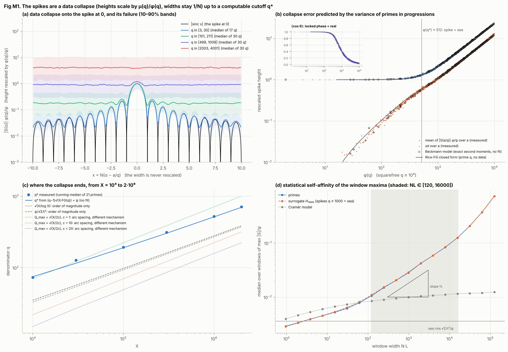
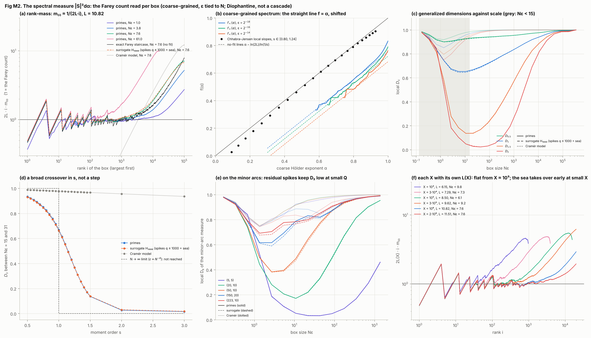
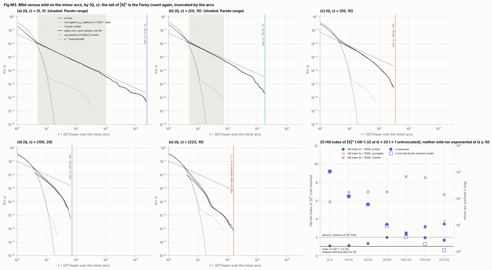
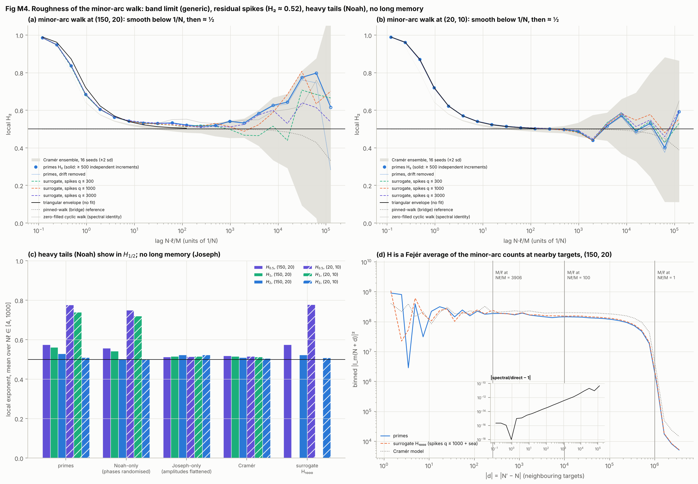
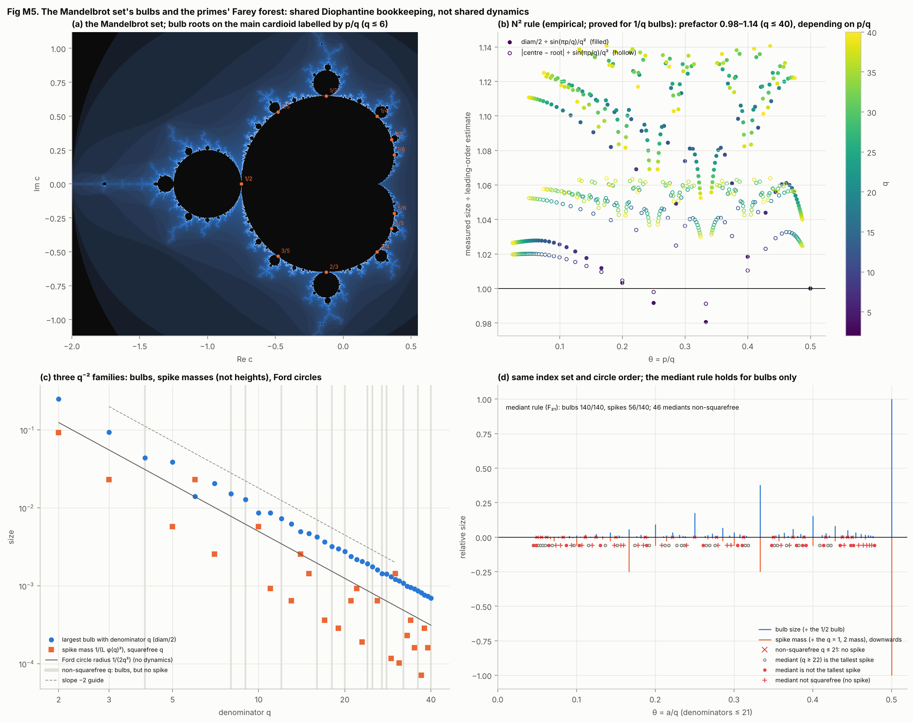
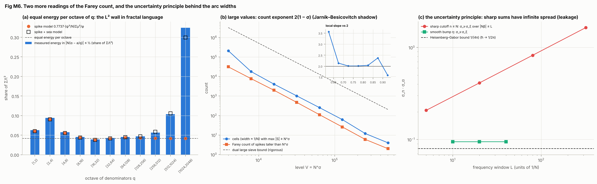

# The fractal lens: Mandelbrot's measurement programme on the circle method at N = 10^6

> Exploration at one finite X, not a proof and not an attempt at one. Every number below is a floating-point statistic
> of one computation at X = N = 10^6 on the grid M = 2^23 (plus the X-scaling runs). Every exponent is a local
> difference quotient at X = 10^6 over a stated window; no trend is fitted, and "no fit" means every constant in a model
> comes from ψ, ΣΛ², μ, φ, N, Q, c or R.

This file applies three of Benoit Mandelbrot's principles to the circle-method objects of results.md and escapes.md, as
measurements. It then compares the primes' rational spikes with the bulbs of the Mandelbrot set:

- **P1. Scaling holds only between cutoffs.** Every exponent comes with its window. Self-similarity (invariance under
  isotropic zoom) is not self-affinity (different rescaling in different directions, or only statistical).
- **P2. Roughness is measured by H; intermittency by D_s and f(α).** The Hurst exponent H measures how rough a walk is.
  The generalized dimensions D_s and the singularity spectrum f(α) measure how unevenly a measure is spread.
- **P3. Mild versus wild randomness; Noah versus Joseph.** Wild (state 6 of Mandelbrot's seven, 1997 ch. E5) means
  infinite variance with some finite positive moment, i.e. Pareto index ≤ 2. The Noah effect is heavy tails; the
  Joseph effect is long memory.

**The one fact.** Almost every scaling law below comes from one counting identity:

    #{a/q : μ(q) ≠ 0, φ(q) ≤ y} = Σ_{μ²(q)=1, φ(q)≤y} φ(q) ~ y²/2,

applied to spikes of height ψ/φ(q) and width 1/N at every reduced a/q with squarefree q, on top of a structureless sea.
The constant is exactly ½. The Dirichlet series is Σ μ²(q)φ(q)^(1−s) = ζ(s−1)·Π_p(1 + (p−1)^(1−s))(1 − p^(1−s)), and
every Euler factor equals 1 at s = 2. Read pointwise, the count is a power-law tail; read per box, a straight-line
spectrum; read per coherence cell, a large-value exponent; read through the fourth moment, the minor-arc kurtosis; read
per octave of q, equal energy per octave. These are one fact read five ways, not five confirmations (the L^(1/2) growth
of the window maxima in M1(d) is a sixth reading, per window). Three scaling laws below are not this fact: the
band-limit crossover of the walk in M4, which any degree-N sum shows; the √L growth of a sharp window's spread in A3; and
the X-scaling of q* in M1(c), which comes from the variance of primes in progressions.

Normalisations used throughout: ψ(X) = 999,586.6, ΣΛ² = 1.28030e7. The trivial atoms at α = 0 and
α = 1/2 (within |Nα| ≤ 20) hold a share 0.1553 of Σ|S|² and are removed before any measure is formed. The
spike-mass normaliser is L = X·P_kept/ψ² = 10.823 (2L = 21.65), so a spike with denominator q carries
mass 1/(Lφ(q)²) of the normalised measure.

## Headline

| block | question | key numbers at X = 10^6 | reading |
|:---|:---|:---|:---|
| M1 spike collapse | does every spike look like the spike at 0, scaled? | q* = 521 measured, 513 from the variance of primes in progressions (no fit) | a data collapse (heights scaled by μ(q)/φ(q), widths fixed at 1/N) for φ(q) ≲ 300 (mean within 8%, sd ≤ 0.33), degrading steadily until spike and sea are equal at φ(q*) ≈ 512; not self-similarity |
| M2 spectral measure | how unevenly is \|S\|²dα spread? | 2L·i·m₍ᵢ₎ (1 = the Farey count): median 0.99 over ranks 8–1024, a sawtooth 0.70–1.43 from the φ-degeneracy that the no-fit Farey staircase reproduces; D₂ = 0.05 vs Cramér 0.92 at Nε ≈ 11 | coarse-grained straight-line spectrum f(α) = α, offset −ln(2L)/ln(1/ε); Diophantine, not a cascade |
| M3 minor-arc tails | is the minor-arc \|S\|² wild or mild? | Hill index of \|S\|² (k = 1000) 1.06 at (5,5), 1.32 at (20,10), 3.16 at (150,20) | a tail near index 1 in \|S\|² over 1.2–2.3 decades at Q ≤ 20 (index 1 only in the untruncated idealisation, where it is wild); neither wild nor exponential at Q ≳ 50 |
| M4 minor-arc walk | how rough is the E0 walk? long memory? | H₂ = 0.531 vs Cramér 0.506 ± 0.003 at Nℓ ∈ [10,100) (z = 8.2); H_½ = 0.78 vs 0.52 at (20,10) | smooth below 1/N (generic); H₂ slightly above ½ from residual spikes; Noah effect yes; no long memory |
| M5 Mandelbrot bulbs | do bulbs and spikes share a hierarchy? | 245/245 bulbs checked; prefactor 0.98–1.14; mediant rule 140/140 (bulbs) vs 56/140 (spikes) | same index set and circle order, q⁻² sizes through Diophantine approximation; not shared dynamics |
| A1 octaves of q | how is the energy spread over denominators? | 0.038–0.044 of ΣΛ² per octave for q ∈ [8, 128) | equal energy per octave: the L² wall in fractal language |
| A2 large values | how many cells have \|S\| ≥ N^σ? | 4,093 cells at σ = 0.7 against 1,990 spikes; large-sieve bound / cells = 50 | count exponent 2(1 − σ) at resolution 1/N: the finite-N shadow of Jarník–Besicovitch |
| A3 uncertainty | why do sharp arcs leak? | sharp cutoff: σ_x·σ_ξ grows like √L; smooth bump 0.0947 = 1.19× the bound 1/(4π) | the Heisenberg–Gabor inequality for conjugate n and α (ħ → 1/2π): literal |

## 0. Certificates

Every identity the experiments rely on, checked at full scale (the run aborts if one fails).

| check | result | detail |
|:---|:---|:---|
| spike-count constant: sum_{phi <= 10^4} mu^2 phi / (10^8/2) | pass | 1.0022 |
| all-a FFT = S_rational (20 random a/q, q <= 10^4) | pass | max \|diff\| = 2.3e-16 psi |
| second-moment identity q = 101 | pass | rel 2.0e-15 |
| second-moment identity q = 210 | pass | rel 1.7e-15 |
| second-moment identity q = 1001 | pass | rel 1.2e-14 |
| walk endpoint = escapes I_m at (150, 20) | pass | 17254.35 vs 17254.35, n = 6087464 |
| spectral identity, zero-filled cyclic walk (150, 20) | pass | max rel 2.0e-10 |
| walk endpoint = escapes I_m at (20, 10) | pass | -78045.44 vs -78045.44, n = 8367136 |
| spectral identity, zero-filled cyclic walk (20, 10) | pass | max rel 2.3e-10 |
| Parseval, primes | pass | 1.280299e+07 |
| Parseval, Cramer | pass |  |
| Parseval, hybrid R = 300 | pass |  |
| Parseval, hybrid R = 1000 | pass |  |
| Parseval, hybrid R = 3000 | pass |  |
| atom share and L | pass | atoms 0.1553, L 10.823 |
| kappa and sup^2 = escapes at (5, 5) | pass | kappa 1045.3824 |
| kappa and sup^2 = escapes at (10, 10) | pass | kappa 120.1890 |
| kappa and sup^2 = escapes at (20, 10) | pass | kappa 59.7590 |
| kappa and sup^2 = escapes at (50, 10) | pass | kappa 10.5373 |
| kappa and sup^2 = escapes at (100, 20) | pass | kappa 4.9267 |
| kappa and sup^2 = escapes at (150, 20) | pass | kappa 3.3116 |
| kappa and sup^2 = escapes at (223, 10) | pass | kappa 2.6424 |
| Mandelbrot bulbs q <= 40, p/q <= 1/2 (the rest by conjugation): period, rotation number, root continuation | pass | 245/245 in 1.2 s |
| bulb 1/2: diam/2 = 1/4 | pass | 0.250000000000 |

## M1. Spike data collapse and its cutoffs (fig_M1)

At a reduced fraction a/q with squarefree q the major-arc approximation is S(a/q + β) ≈ (μ(q)/φ(q))·(ψ/X)·v(β), with
|v(β)|/X ≈ |sinc(Nβ)|. Every spike would then be the spike at 0, with its height divided by φ(q) and its width
unchanged. This is a **data collapse** (heights rescaled, widths fixed at 1/N), not invariance under zoom. How far does
it hold, and what ends it?

**(a) Zoom collapse.** y = |S(α)|φ(q)/ψ against x = N(α − a/q), for four classes of q (every squarefree q in the class,
up to 50 evenly spaced reduced a per q). Values at the spike centre:

| q class | # q | median y at x ≈ 0 | 10–90% band |
|:---|---:|---:|---:|
| [3, 30] | 17 | 0.994 | 0.983–1.008 |
| [101, 211] | 69 | 1.001 | 0.873–1.141 |
| [499, 1009] | 310 | 1.243 | 0.629–2.280 |
| [2003, 4001] | 1217 | 3.708 | 1.277–8.677 |

For the smallest class the median profile matches |sinc x| to 0.50% at |x| ≤ 0.5. By q ≈ 500–1000 the
heights scatter by a factor of two (the collapse has failed). By q ≈ 2000–4000 the "spike" is sea.

**(b) The collapse error is predicted by the variance of primes in progressions.** Write Z_a = μ(q)S(a/q)φ(q)/ψ − 1.
Over the reduced a, E|Z|² and E[Z²] are exact second moments (E[Z²] is real, because a → −a conjugates). The
residue-class variance V(q) = Σ_{(r,q)=1}(ψ(X;q,r) − ψ_c/φ(q))² (Barban–Davenport–Halberstam, Montgomery–Hooley)
behaves like X·FG(q), FG(q) = ln q − γ − ln 2π − Σ_{p|q} ln p/(p−1) (Friedlander–Goldston form). Two models:
a **Beckmann model** y = |1 + X + iY| with X, Y independent Gaussians carrying the exact E|Z|², E[Z²] (an 80×80
Gauss–Hermite rule); and for prime q the **Rice-FG closed form** with σ² = (q−1)²X·FG(q)/ψ², which uses no data at all.

| q | φ(q) | measured mean / sd / ⟨cos θ⟩ | Beckmann (exact 2nd moments) | Rice-FG (prime q, no data) |
|---:|---:|---:|---:|:---|
| 101 | 100 | 1.005 / 0.103 / 0.994 | 1.006 / 0.104 / 0.994 | 1.005 / 0.104 / 0.995 |
| 210 | 48 | 1.002 / 0.030 / 0.998 | 1.002 / 0.031 / 0.998 | n/a (composite) |
| 301 | 252 | 1.053 / 0.282 / 0.947 | 1.055 / 0.278 / 0.944 | n/a (composite) |
| 499 | 498 | 1.263 / 0.549 / 0.728 | 1.267 / 0.553 / 0.742 | 1.265 / 0.583 / 0.724 |
| 1001 | 720 | 1.653 / 0.773 / 0.524 | 1.635 / 0.811 / 0.537 | n/a (composite) |
| 2003 | 2002 | 4.185 / 2.051 / 0.204 | 4.135 / 2.157 / 0.198 | 4.138 / 2.162 / 0.192 |
| 4001 | 4000 | 8.619 / 4.527 / 0.092 | 8.628 / 4.518 / 0.093 | 8.643 / 4.518 / 0.091 |
| 2310 | 480 | 1.230 / 0.571 / 0.758 | 1.239 / 0.551 / 0.751 | n/a (composite) |

The isotropic Rice model with the measured E|Z|² gets the spike-dominated regime wrong: at q = 210 it gives sd
0.054 against the measured 0.030; Beckmann's anisotropy fixes it. For prime q,
E|Z|²·ψ²/(φ(q)²V(q)) = q/(q − 1) up to prime-power classes (1.002 at q = 499). For composite q the off-diagonal
Ramanujan-sum terms make it 1.80 at q = 210, 1.09 at q = 301, 1.13 at q = 1001, so the FG closed form is used for prime q only. V(q)/X against FG:

| prime q | V(q)/X | FG(q) | ratio |
|---:|---:|---:|---:|
| 101 | 2.28 | 2.15 | 1.059 |
| 499 | 3.66 | 3.79 | 0.967 |
| 2003 | 5.17 | 5.18 | 0.997 |
| 4001 | 5.86 | 5.88 | 0.997 |

Median of V/(X·FG) over the 1167 primes in [300, 10^4]: 1.002. The phase-locking order parameter
⟨cos θ⟩ (last number in each triple) falls together with the height collapse: a locked spike is *real* (μ(q)ψ/φ(q),
because the Ramanujan sums c_q(n) are integers), and an unlocked one has a uniformly spread phase.

**(c) Where the spike fades into the sea.** q*(X) is the prime q where spike and sea are equal, (q − 1)√(X·FG(q)) = ψ (brentq;
no fit). Measured q* is the first prime where the running median over 21 consecutive primes of
K(q) = √(mean_a |S(a/q) + ψ_c/(q−1)|²)·(q−1)/ψ exceeds 1:

| X | q* measured | q* from FG (no fit) | √(X/log X) | ψ/√ΣΛ² | Q_max(c = 10) |
|---:|---:|---:|---:|---:|---:|
| 1e4 | 73 | 75 | 33 | 35 | 22 |
| 3e4 | 127 | 115 | 54 | 57 | 38 |
| 1e5 | 193 | 190 | 93 | 98 | 70 |
| 3e5 | 311 | 303 | 154 | 161 | 122 |
| 1e6 | 521 | 513 | 269 | 279 | 223 |
| 2e6 | 709 | 698 | 371 | 385 | 316 |

At X = 10^6, q* = 521 measured against 513 predicted. The early estimate √(X/log X) is
1.9–2.3× too low at every X; ψ/√ΣΛ² is an order of
magnitude only.
q* and the largest admissible arc range Q_max = √(X/2c) both grow like √X up to logarithms, **for different reasons**:
q* compares spike height with the sea; Q_max compares arc width c/N with the Farey spacing 1/Q², and depends on c. They
do not coincide.

**(d) Statistical self-affinity of the window maxima.** Median over non-overlapping windows of 2^j grid points of
max|S|/ψ:

| N·L | primes | surrogate H₁₀₀₀ | Cramér |
|---:|---:|---:|---:|
| 0.954 | 2.887e-03 | 2.843e-03 | 3.967e-03 |
| 3.81 | 3.914e-03 | 3.881e-03 | 5.302e-03 |
| 15.3 | 5.237e-03 | 5.331e-03 | 6.693e-03 |
| 61 | 7.837e-03 | 8.130e-03 | 7.916e-03 |
| 244 | 1.496e-02 | 1.524e-02 | 8.978e-03 |
| 977 | 2.819e-02 | 2.887e-02 | 9.945e-03 |
| 3.91e+03 | 5.864e-02 | 5.872e-02 | 1.071e-02 |
| 1.56e+04 | 1.252e-01 | 1.258e-01 | 1.157e-02 |
| 6.25e+04 | 3.743e-01 | 3.739e-01 | 1.194e-02 |

Local slope (primes) 0.45–0.58 for N·L ∈ [120, 16000] and 0.21–0.34 below N·L ≈ 60 (sea). The slope ½ is the
Farey count read per window: a window of width L (as a fraction of the circle) holds about L·y²/2 fractions with φ ≤ y, so its tallest spike has φ ~ (2/L)^(1/2) and height ∝ L^(1/2). It is a
statistical self-affine scaling of one statistic between the sea floor and the q ≤ 5 spikes, not a test of self-affinity
of the whole graph.

**Shows.** The major-arc spike picture holds as a data collapse for φ(q) ≲ 300 (binned medians: mean 1.08, sd 0.33 at
φ ≈ 250–320) and then degrades steadily (mean 1.23, sd 0.51 at φ ≈ 400–520). Its mean, spread and phase locking are
predicted from the exact second moments of S(a/q) for every q (Beckmann), and with no data at all from the variance of
primes in progressions for prime q (Rice-FG), until spike and sea are equal at the computable q*(X).
Phase locking (⟨cos θ⟩ → 1) and the height collapse fail together. **Does not show.** Any
self-similarity under zoom; any link between q* and an admissible arc range; anything asymptotic (FG is a conjectural
asymptotic, checked at these X only).

## M2. Intermittency of the spectral measure: the Farey spectrum (fig_M2)

The measure is μ = |S|²dα with the atoms at 0 and 1/2 removed, normalised to 1. Boxes hold 2^j grid points:
ε = 2^(j−23), Nε = 0.119·2^j. A spike with denominator q carries mass m_q = 1/(Lφ(q)²) and sits in one box (or two).
Ordering spikes by φ and using the Farey count gives, with no fit,

    N_<(α; ε) = #{boxes: μ_box ≥ ε^α} = ε^(−α)/(2L)  ⇔  f_<(α) = α − ln(2L)/ln(1/ε)  ⇔  m₍ᵢ₎ = 1/(2L·i).

It is exact in expectation (box counting is linear in mass, and split spikes do not change the expected count). This is a
**coarse-grained** spectrum with ε tied to N. As N → ∞ at fixed ε every m_q → 0 and the measure tends to Lebesgue
measure; with ε = N^(−θ), 0 < θ < 1, τ(s) = min(0, s − 1), so D_s = 1 for s < 1 and 0 for s > 1, and the offset vanishes
like ln ln N/ln N. Neither limit is reached here.

**(a) Rank–mass.** Compensated 2L·i·m₍ᵢ₎ at Nε = 7.6 (j = 6), against the exact Farey staircase (squarefree
q ≥ 3 sorted by φ; φ(q) boxes of mass κ(Nε)/(Lφ²) + ρε each, with κ = 0.928 the expected capture of a
spike by a box and ρ = 0.423 the sea level from the surrogate):

| rank i | primes | Farey staircase (no fit) | surrogate H₁₀₀₀ | Cramér |
|---:|---:|---:|---:|---:|
| 2 | 0.97 | 0.93 | 0.97 | 0.0021 |
| 4 | 1.94 | 1.86 | 1.94 | 0.0026 |
| 8 | 0.97 | 0.93 | 0.97 | 0.0044 |
| 16 | 0.86 | 0.83 | 0.87 | 0.0076 |
| 32 | 0.97 | 0.93 | 0.97 | 0.015 |
| 64 | 0.88 | 0.83 | 0.90 | 0.027 |
| 128 | 0.96 | 0.94 | 0.97 | 0.052 |
| 256 | 0.99 | 1.00 | 0.98 | 0.099 |
| 512 | 0.99 | 0.96 | 1.00 | 0.18 |
| 1024 | 1.04 | 0.97 | 1.08 | 0.34 |

The value at i = 4 is the φ = 2 degeneracy (q = 3 and 6 share φ = 2). Between consecutive φ-groups the curve is a
sawtooth, 0.70–1.43 over ranks 8–1024 (median 0.99), and the staircase reproduces it; the table shows powers of 2
only. Cramér has no flat branch.

**(b) Cumulative spectrum.** Compensated N_<·2L·ε^α (1 = the no-fit line; in parentheses below α_lo, where fewer than
60 boxes count), with the no-fit offset and the measured mean of f_< − α over [α_lo, 0.9]:

| ε | α = 0.6 | 0.7 | 0.8 | 0.9 | offset −ln(2L)/ln(1/ε) | measured mean f − α | α_lo (N_< ≥ 60) |
|:---|---:|---:|---:|---:|---:|---:|---:|
| 2^-18 | 1.21 | 0.97 | 1.00 | 1.15 | -0.246 | -0.246 | 0.57 |
| 2^-16 | (1.12) | 0.99 | 1.08 | 1.14 | -0.277 | -0.274 | 0.65 |
| 2^-14 | (0.77) | (0.97) | 0.99 | 1.26 | -0.317 | -0.305 | 0.74 |

Exact staircase count at ε = 2^-14 (Nε = 61):

| A | boxes with μ ≥ ε^A (data) | Farey staircase (model) |
|---:|---:|---:|
| 0.5 | 4 | 4 |
| 0.6 | 12 | 12 |
| 0.7 | 40 | 40 |
| 0.8 | 108 | 108 |
| 0.9 | 360 | 356 |

Chhabra–Jensen local slopes between ε and 4ε (ε = 2^-18 → 2^-16) lie on f = α with **no** offset, because a scale
difference removes the constant ln(2L). They show the kink of τ(s) at s ≈ 1, not an independent spectrum:

| s | α(s) | f(s) |
|---:|---:|---:|
| 0.8 | 0.93 | 0.90 |
| 0.9 | 0.82 | 0.82 |
| 1.0 | 0.65 | 0.65 |
| 1.1 | 0.42 | 0.41 |
| 1.2 | 0.17 | 0.13 |

**(c) Generalized dimensions against scale.** Local D_s between consecutive box sizes, at Nε ≈ 10.8 (j = 6 → 7):

| s | primes | surrogate H₁₀₀₀ | Cramér |
|---:|---:|---:|---:|
| 0.5 | 0.93 | 0.92 | 0.98 |
| 0.8 | 0.82 | 0.81 | 0.97 |
| 0.9 | 0.75 | 0.74 | 0.96 |
| 1.0 | 0.65 | 0.65 | 0.96 |
| 1.1 | 0.54 | 0.53 | 0.95 |
| 1.2 | 0.41 | 0.40 | 0.95 |
| 1.5 | 0.14 | 0.14 | 0.94 |
| 2.0 | 0.05 | 0.05 | 0.92 |
| 3.0 | 0.03 | 0.03 | 0.89 |

D₂ against box size (D_1 is the Shannon information dimension):

| Nε | D₂ primes | D₂ surrogate | D₂ Cramér |
|---:|---:|---:|---:|
| 0.169 | 0.98 | 0.98 | 0.98 |
| 0.337 | 0.92 | 0.92 | 0.94 |
| 0.674 | 0.85 | 0.84 | 0.83 |
| 1.35 | 0.53 | 0.53 | 0.75 |
| 2.7 | 0.18 | 0.18 | 0.80 |
| 5.39 | 0.10 | 0.10 | 0.87 |
| 10.8 | 0.05 | 0.05 | 0.92 |
| 21.6 | 0.03 | 0.03 | 0.96 |
| 43.2 | 0.02 | 0.02 | 0.98 |
| 86.3 | 0.03 | 0.03 | 0.99 |
| 173 | 0.05 | 0.05 | 0.99 |
| 345 | 0.10 | 0.10 | 1.00 |
| 691 | 0.19 | 0.19 | 1.00 |
| 1.38e+03 | 0.33 | 0.33 | 1.00 |

Below Nε ≈ 15 Gamma fluctuations of 1–15 cells move even Cramér. Acceptance of the surrogate: max |D₂(H₁₀₀₀) − D₂(primes)|
over Nε ∈ [3.8, 122] = 0.003. D_(s≥2) ≈ 0 is the four q = 3 and q = 6 spikes (mass 1/(4L) = 2.3% of μ
each; the largest box at Nε = 7.6 holds 2.2%); any measure with one unresolved atom
does this, so it is not evidence of a hierarchy.

**(d) D_s against s** (local slope at Nε 15 → 31):

| s | 0.5 | 0.8 | 0.9 | 1.0 | 1.1 | 1.2 | 1.3 | 1.5 | 2.0 | 3.0 |
|:---|---:|---:|---:|---:|---:|---:|---:|---:|---:|---:|
| primes | 0.93 | 0.82 | 0.76 | 0.67 | 0.56 | 0.43 | 0.31 | 0.14 | 0.03 | 0.02 |
| surrogate | 0.93 | 0.82 | 0.75 | 0.66 | 0.55 | 0.43 | 0.31 | 0.14 | 0.03 | 0.02 |
| Cramér | 0.99 | 0.98 | 0.98 | 0.98 | 0.98 | 0.97 | 0.97 | 0.97 | 0.96 | 0.94 |

A broad crossover from ≈ 1 (s < 1) to ≈ 0 (s > 1) between s ≈ 0.8 and 1.5. The step is only the N → ∞ limit.

**(e) Minor-arc measure** μ_m = |S|²·1_m/Σ (the atoms sit in the major arcs). Local D₂ at Nε = 21.6 and its minimum
over Nε ∈ [15, 977] (box sizes where Cramér is ≈ 1), and the boxes of the full-circle measure with α < 0.9 that lie
entirely in the minor arcs at ε = 2^-18:

| (Q,c) | D₂ primes: at Nε 21.6 / min | surrogate | Cramér | # α < 0.9 boxes inside m (ε = 2^-18) | their α_min | share of minor mass |
|---:|:---|:---|:---|---:|---:|---:|
| (5,5) | 0.03 / 0.03 (Nε 43.2) | 0.04 / 0.03 (Nε 43.2) | 0.94 / 0.94 (Nε 21.6) | 3974 | 0.307 | 34.5% |
| (20,10) | 0.22 / 0.22 (Nε 21.6) | 0.22 / 0.22 (Nε 21.6) | 0.96 / 0.96 (Nε 21.6) | 3766 | 0.528 | 23.3% |
| (50,10) | 0.64 / 0.64 (Nε 21.6) | 0.63 / 0.63 (Nε 21.6) | 0.95 / 0.95 (Nε 21.6) | 3198 | 0.673 | 13.9% |
| (150,20) | 0.83 / 0.82 (Nε 43.2) | 0.82 / 0.81 (Nε 43.2) | 0.88 / 0.85 (Nε 43.2) | 899 | 0.804 | 3.7% |
| (223,10) | 0.80 / 0.80 (Nε 21.6) | 0.79 / 0.79 (Nε 21.6) | 0.81 / 0.81 (Nε 21.6) | 234 | 0.825 | 0.9% |

**(f) X-scaling.** The compensated rank–mass at the box with Nε nearest 8, for six X, each with its own L(X). Between
consecutive φ-groups the curve is a sawtooth (about 0.7–1.4 over i ∈ [8, 256] at every X ≥ 10^5), so the table gives the
median over every rank in [8, 256] and the values at powers of 2:

| X | L(X) | L − ln X | Nε | median of 2L·i·m₍ᵢ₎, i ∈ [8, 256] | at i = 8, 16, …, 256 | at i = 512 |
|---:|---:|---:|---:|---:|---:|---:|
| 1e4 | 6.152 | -3.058 | 9.8 | 1.85 | 0.94–2.58 | 3.86 |
| 3e4 | 7.293 | -3.016 | 7.3 | 1.20 | 0.88–1.32 | 1.87 |
| 1e5 | 8.500 | -3.013 | 6.1 | 1.01 | 0.87–1.04 | 1.12 |
| 3e5 | 9.622 | -2.990 | 9.2 | 0.99 | 0.87–1.00 | 1.09 |
| 1e6 | 10.823 | -2.992 | 7.6 | 0.96 | 0.86–0.99 | 0.99 |
| 2e6 | 11.513 | -2.995 | 7.6 | 0.96 | 0.86–0.97 | 0.99 |

L(X) − ln X lies between -3.058 and -2.990 at every X. The flat branch holds from X ≈ 10^5 (medians 0.96–1.01); at X ≤ 3·10^4 the sea takes over within the first few hundred ranks.

**Shows.** f = α for α < 1 and D_s(ε) are quantitative consequences of the Farey count with heights ψ/φ(q); the surrogate
made of singular-series spikes q ≤ 1000 plus a structureless sea reproduces every curve, and Cramér is a monofractal
point. A straight-line spectrum is the signature of Diophantine counting (as in Jaffard's spectrum of Riemann's
function), not of a multiplicative cascade. **Does not show.** A fine (Hausdorff) spectrum: the rationals have
dimension 0. A cascade. A D_s step at this N.

## M3. Mild versus wild on the minor arcs, by (Q,c) (fig_M3)

Take α uniform on the minor arcs and t = |S|²/mean_m. A spike of height ψ/φ(q) for each of the ≈ y²/2 reduced fractions
with φ(q) ≤ y gives

    P(|S|² > t·mean_m) ≈ ψ²/(2N|m|·t·mean_m),

a power law of index 1 in |S|² (index 2 in |S|): the wild/pre-wild boundary for |S|. (∫_0^1 u·m(u)du = ½∫sinc² = ½ with
m(u) = |{|sinc| > u}|.) The arcs truncate it: spikes with q ≤ Q are cut out within c/N of their centre. A semi-analytic
sum over spikes, P_model(t) = (1/(N|m|))Σ_q φ(q)·ℓ_q(u_q) with ℓ_q the measure of {|sinc x| > u} outside the arc, carries
the truncation with no fit. The largest surviving value is predicted as max(ψ/φ_min(Q), ψ/(π(c + ½)))²: the smallest-φ
spike above Q, or the first arc-edge sidelobe of q = 1, 2. Mandelbrot's operational tests run on coherence cells of 8 grid
points (≈ 1/N) lying entirely in the minor arcs: the Hill index of the cell maxima and the concentration of energy in
the largest cells. The fourth-moment model ∫_m|S|⁴ ≈ (ψ⁴/N)[(2/3)Σ_{q>Q}μ²/φ³ + T4(c)Σ_{q≤Q}μ²/φ³], T4(c) = 2∫_c^∞ sinc⁴,
predicts the kurtosis κ = mean_m|S|⁴/(mean_m|S|²)².

| (Q,c) | κ | κ model / measured | sup²/mean | predicted sup² / measured | active term | Pareto range | Hill k = 300 / 1000 / 3000 / 10⁴ | Hill Cramér (k = 1000) | κ Cramér |
|---:|---:|---:|---:|---:|:---|:---|---:|---:|---:|
| (5,5) | 1045 | 0.999 | 24581.8 | 1.005 | q = 6 (φ = 2) | [5, 983] | 1.13 / 1.06 / 1.04 / 1.05 | 5.85 | 2.157 |
| (10,10) | 120.2 | 0.992 | 3017.0 | 1.002 | q = 14 (φ = 6) | [5, 121] | 1.29 / 1.08 / 1.08 / 1.08 | 6.91 | 2.016 |
| (20,10) | 59.76 | 0.982 | 1820.1 | 0.997 | q = 30 (φ = 8) | [5, 73] | 1.47 / 1.32 / 1.21 / 1.14 | 6.93 | 2.016 |
| (50,10) | 10.54 | 0.878 | 347.9 | 0.935 | q = 66 (φ = 20) | none | 2.47 / 1.98 / 1.65 / 1.36 | 6.95 | 2.017 |
| (100,20) | 4.927 | 0.716 | 142.3 | 0.951 | q = 102 (φ = 32) | none | 3.03 / 2.31 / 1.98 / 1.77 | 8.60 | 2.002 |
| (150,20) | 3.312 | 0.574 | 71.8 | 0.868 | q = 210 (φ = 48) | none | 4.48 / 3.16 / 2.37 / 2.04 | 8.49 | 2.001 |
| (223,10) | 2.642 | 0.420 | 156.4 | 0.889 | arc-edge sidelobe of q = 1, 2 | none | 3.81 / 3.44 / 2.93 / 2.59 | 6.66 | 2.025 |

The fourth-moment model counts spikes only. It holds to 0.982–0.999 at Q ≤ 20; from Q ≈ 50 on the sea adds to ∫_m|S|⁴ and
the model falls short (0.88 at (50,10), 0.72 at (100,20), 0.57 at (150,20), 0.42 at (223,10)). The Pareto range is [5, 0.04·sup²/mean]; a power law is claimed only where it spans a
decade. κ and sup² equal escapes.md
E1's values to 1e-9 (certificate). Concentration (share of the minor-arc energy in the top cells; the exponential
reference f(1 + ln(1/f)) gives 0.0010, 0.0079, 0.0561, 0.330):

| (Q,c) | primes top 0.01% | 0.1% | 1% | 10% | Cramér 0.01% | 0.1% | 1% | 10% |
|---:|---:|---:|---:|---:|---:|---:|---:|---:|
| (5,5) | 0.142 | 0.246 | 0.361 | 0.553 | 0.002 | 0.007 | 0.048 | 0.289 |
| (10,10) | 0.077 | 0.176 | 0.298 | 0.508 | 0.001 | 0.007 | 0.048 | 0.289 |
| (20,10) | 0.052 | 0.133 | 0.254 | 0.476 | 0.001 | 0.007 | 0.048 | 0.289 |
| (50,10) | 0.015 | 0.063 | 0.173 | 0.414 | 0.001 | 0.007 | 0.048 | 0.289 |
| (100,20) | 0.008 | 0.037 | 0.123 | 0.374 | 0.001 | 0.007 | 0.048 | 0.289 |
| (150,20) | 0.004 | 0.023 | 0.097 | 0.351 | 0.001 | 0.007 | 0.048 | 0.289 |
| (223,10) | 0.003 | 0.016 | 0.074 | 0.324 | 0.001 | 0.007 | 0.048 | 0.289 |

The tail against the spike-sum model and the surrogate:

| (Q,c) | t | primes P(> t) | spike-sum model | measured / model | surrogate | Cramér |
|---:|---:|---:|---:|---:|---:|---:|
| (5,5) | 8 | 0.00663 | 0.0062 | 1.070 | 0.00709 | 0.000368 |
| (5,5) | 16 | 0.00318 | 0.00307 | 1.037 | 0.00326 | 2e-05 |
| (5,5) | 32 | 0.0015 | 0.00148 | 1.016 | 0.00154 | 1.19e-05 |
| (5,5) | 64 | 0.000721 | 0.000709 | 1.017 | 0.000739 | 6.44e-06 |
| (5,5) | 128 | 0.000361 | 0.000359 | 1.007 | 0.000361 | 2.86e-06 |
| (5,5) | 256 | 0.00017 | 0.000169 | 1.003 | 0.000173 | 7.15e-07 |
| (5,5) | 512 | 9.11e-05 | 9.05e-05 | 1.006 | 8.92e-05 | 0 |
| (5,5) | 1024 | 3.29e-05 | 3.31e-05 | 0.994 | 3.39e-05 | 0 |
| (5,5) | 2048 | 1.45e-05 | 1.45e-05 | 1.003 | 1.43e-05 | 0 |
| (5,5) | 4096 | 5.48e-06 | 5.45e-06 | 1.006 | 5.48e-06 | 0 |
| (20,10) | 8 | 0.00749 | 0.00685 | 1.094 | 0.00808 | 0.000362 |
| (20,10) | 64 | 0.000678 | 0.000678 | 1.000 | 0.000697 | 7.17e-07 |
| (20,10) | 512 | 4.54e-05 | 4.5e-05 | 1.008 | 4.54e-05 | 0 |

At (150,20) the surrogate against the primes:

| t | primes | surrogate H₁₀₀₀ | surrogate / primes | Cramér | e^(−t) |
|---:|---:|---:|---:|---:|---:|
| 4 | 0.0248 | 0.0285 | 1.15 | 0.0183 | 0.0183 |
| 8 | 0.00565 | 0.00672 | 1.19 | 0.00033 | 0.000335 |
| 16 | 0.00139 | 0.00161 | 1.16 | 3.94e-06 | 1.13e-07 |
| 32 | 0.000227 | 0.00027 | 1.19 | 0 | 1.27e-14 |
| 64 | 4.93e-06 | 5.26e-06 | 1.07 | 0 | 1.6e-28 |

At (150,20) P(> 8) = 0.00565 against 0.000335 for an exponential law
(17×).

**Reading.** At Q ≤ 20 the minor arcs still carry the near-rational tail over 1.2–2.3 decades (the
Pareto ranges above). The measured Hill
index of |S|² is 1.04–1.47, i.e. 2.1–2.9 in |S|: the arc truncation steepens the measured tail above the idealised index 1 in
|S|² (2 in |S|). That idealised tail sits exactly on Mandelbrot's wild/pre-wild boundary for |S| (state 6 needs Pareto
index ≤ 2), so the minor arcs at Q ≤ 20 are wild only **in the untruncated idealisation**; the measured, truncated
tail is pre-wild in |S|. At finite N every moment is finite in any case; the tail is never "extreme" (state 7 needs every
moment infinite). For Q ≳ 50 the arcs cut the tail off within a decade of the bulk. What remains is **neither wild nor
exponential**: deterministic residual spikes on a sea. Over t ∈ [4, 32] the singular-series surrogate's P(> t) is
2–13% high at Q ≤ 20 and 4–14% high at (50,10), where spikes dominate, but 13–21% high at (150,20) and 17–56% high at (223,10), where the sea matters: there it
reproduces the shape only roughly. Cramér is exponential in |S|² in the bulk (borderline mild); beyond t ≈ 10 the
arc-edge sidelobes of its single q = 1 spike add a power-law piece of ≈ 10⁻⁵ (max/mean 307 at (5,5)). The fourth-moment model, the Pareto tail and κ are the same fact. The
ternary bound's sup is an order statistic of the truncated tail. **Does not show.** That any tail is wild at finite N;
probability over primes (the randomness here is uniform α); anything beyond the surrogate.

## M4. Roughness of the minor-arc walk: band limit, Noah, Joseph (fig_M4)

The walk is E0's: k runs over the sorted minor-arc grid indices, w_j = S(k_j/M)²e(−Nk_j/M)/M, and F = cumsum(w) ends at
I_m(N) (certificate). Structure functions S_p(ℓ) = mean_j|F_(j+ℓ) − F_j|^p give local exponents
H_p = (1/p)·Δln S_p/Δln ℓ between ℓ and 2ℓ. Nulls: a 16-seed Cramér ensemble on the same mask; the surrogate H_R for
R = 300, 1000, 3000; a **Noah-only** walk |w|e^(iθ) with random θ (keeps the tails, destroys the phases); and a
**Joseph-only** walk w/|w| (keeps the phases, flattens the tails). Verdict words were fixed in advance: "excess" if
z ≥ 3 and no seed reaches the primes, "marginal" if 2 ≤ z < 3, "none" if z < 2. The label "below" (z ≤ −2) was added
afterwards, for the one band where the primes fall under the ensemble.

**(150,20)** (n = 6,087,464 minor points):

| band of Nℓ | n/ℓ | primes H₂ | Cramér, 16 seeds | z | seeds ≥ primes | verdict | surrogate R = 300 / 1000 / 3000 |
|:---|---:|---:|:---|---:|---:|:---|---:|
| [0.5, 1) | 760,933 | 0.685 | 0.642 ± 0.001 | +65.1 | 0/16 | excess | 0.681 / 0.685 / 0.687 |
| [1, 10) | 380,466–95,117 | 0.570 | 0.547 ± 0.001 | +20.3 | 0/16 | excess | 0.570 / 0.570 / 0.572 |
| [10, 100) | 47,558–11,890 | 0.531 | 0.506 ± 0.003 | +8.2 | 0/16 | excess | 0.526 / 0.526 / 0.532 |
| [100, 1000) | 5,945–743 | 0.524 | 0.498 ± 0.012 | +2.2 | 0/16 | marginal | 0.512 / 0.518 / 0.513 |
| [1000, 3000) | 372 | 0.532 | 0.505 ± 0.026 | +1.0 | 1/16 | none | 0.467 / 0.488 / 0.525 |
| [3000, 50000) | 186–23 | 0.657 | 0.487 ± 0.084 | +2.0 | 0/16 | marginal | 0.532 / 0.650 / 0.586 |

**(20,10)** (n = 8,367,136 minor points):

| band of Nℓ | n/ℓ | primes H₂ | Cramér, 16 seeds | z | seeds ≥ primes | verdict | surrogate R = 300 / 1000 / 3000 |
|:---|---:|---:|:---|---:|---:|:---|---:|
| [0.5, 1) | 1,045,892 | 0.719 | 0.644 ± 0.001 | +137.9 | 0/16 | excess | 0.719 / 0.719 / 0.719 |
| [1, 10) | 522,946–130,736 | 0.578 | 0.549 ± 0.001 | +32.5 | 0/16 | excess | 0.578 / 0.577 / 0.578 |
| [10, 100) | 65,368–16,342 | 0.515 | 0.504 ± 0.002 | +6.5 | 0/16 | excess | 0.515 / 0.515 / 0.515 |
| [100, 1000) | 8,171–1,021 | 0.497 | 0.497 ± 0.008 | +0.0 | 11/16 | none | 0.496 / 0.495 / 0.499 |
| [1000, 3000) | 511 | 0.440 | 0.511 ± 0.032 | -2.2 | 15/16 | below | 0.439 / 0.439 / 0.448 |
| [3000, 50000) | 255–32 | 0.527 | 0.515 ± 0.065 | +0.2 | 7/16 | none | 0.538 / 0.557 / 0.545 |

Drift removal (S₂ − |mean increment|², an exact identity) changes H₂ by at most 0.002 wherever n/ℓ ≥ 500.

**Smooth below 1/N, then diffusive.** Any degree-N sum is smooth below its band limit, and Cramér's model shows the same
crossover. For the primes its shape follows, with no fit, the triangular envelope of the binary counts carried by the
residual spikes, S₂(x) ∝ ∫_0^1(1 − u)²sin²(πux)/u² du, x = Nℓ/M:

| Nℓ/M | triangular envelope (no fit) | primes (20,10) | primes (150,20) | Cramér mean (20,10) |
|---:|---:|---:|---:|---:|
| 0.119 | 0.990 | 0.990 | 0.986 | 0.983 |
| 0.238 | 0.962 | 0.961 | 0.949 | 0.937 |
| 0.477 | 0.873 | 0.870 | 0.837 | 0.802 |
| 0.954 | 0.722 | 0.719 | 0.685 | 0.644 |
| 1.91 | 0.623 | 0.623 | 0.605 | 0.579 |
| 3.81 | 0.570 | 0.570 | 0.564 | 0.545 |
| 7.63 | 0.540 | 0.541 | 0.542 | 0.524 |
| 15.3 | 0.523 | 0.524 | 0.531 | 0.511 |
| 30.5 | 0.513 | 0.514 | 0.530 | 0.503 |

Largest deviation from the envelope at (20,10), x ≤ 30: 0.0023. At (150,20) the mask removes 27% of the circle,
and the deviations are larger.

**Noah and Joseph.** Band means over Nℓ ∈ [4, 1000]:

| (Q,c) | walk | H_½ | H₁ | H₂ |
|---:|:---|---:|:---|---:|
| (150,20) | primes | 0.574 | 0.562 | 0.529 |
| (150,20) | Noah-only (phases randomised) | 0.557 | 0.543 | 0.502 |
| (150,20) | Joseph-only (amplitudes flattened) | 0.513 | 0.517 | 0.524 |
| (150,20) | Cramér | 0.518 | 0.515 | 0.509 |
| (150,20) | surrogate H₁₀₀₀ | 0.575 | — | 0.524 |
| (20,10) | primes | 0.777 | 0.739 | 0.509 |
| (20,10) | Noah-only (phases randomised) | 0.750 | 0.720 | 0.500 |
| (20,10) | Joseph-only (amplitudes flattened) | 0.514 | 0.516 | 0.523 |
| (20,10) | Cramér | 0.515 | 0.512 | 0.505 |
| (20,10) | surrogate H₁₀₀₀ | 0.777 | — | 0.508 |

Over 16 random-phase seeds the Noah-only H₂ spans 0.481–0.516 at (150,20); 0.464–0.555 at (20,10) wherever n/ℓ ≥ 1500. The check 0.50 ± 0.02 holds
for 16/16 seeds at (150,20) and 4/16 seeds at (20,10): at (20,10) a handful of the largest steps dominate the phase-randomised walk, so the seed
moves it by up to 0.05, and the check is only as good as that. H_½ well above ½ for the primes and for the phase-randomised walk, but not for Cramér,
is the Noah effect (heavy tails), at (20,10) above all.

The Joseph-only walk (w/|w|) has H_½ ≈ H₁ ≈ 0.51 (no heavy tails). Its H₂ over
Nℓ ∈ [4, 1000] is 0.524 against 0.501 for Cramér's Joseph-only walk at (150,20), where the
full walk has 0.529; at (20,10) it is 0.523 against
0.500, while the full walk is 0.509 against
0.505. At Nℓ ∈ [3000, 50000) it gives 0.647 at (150,20) (full walk
0.657, Noah-only 0.531) but also 0.572 at (20,10), where the full walk shows
no rise (0.527). Flattening the amplitudes re-weights the walk, so w/|w| is not a clean split into tails
and memory: it can create an excess the full walk does not have. It does not support a memory reading either way.

**No long memory.** The primes' H₂ exceeds the Cramér ensemble decisively only at Nℓ < 100, where the residual spikes
set it (the triangular envelope at (20,10)). Beyond that the verdicts are "marginal" or "none" at (150,20) and "none" or
"below" at (20,10). The rise at the largest lags at (150,20) (H₂ = 0.657, z = 2.0) rests on
186–23 independent increments; the surrogates give 0.532, 0.650 and
0.586 for R = 300, 1000 and 3000, so this band is dominated by a few deterministic residual spikes and
by noise, not by memory. The dip at (20,10), Nℓ ∈ [1000, 3000) (H₂ = 0.440, z = -2.2), is
reproduced by every surrogate (0.439–0.448).

**Spectral identity.** For the zero-filled cyclic walk, S₂^cyc(ℓ) = (1/M²)Σ_d|I_m(N + d)|²·sin²(πdℓ/M)/sin²(πd/M)
exactly (certificate), so that walk's H at lag ℓ is a Fejér average of the minor-arc counts I_m(N') over
|N' − N| ≲ M/ℓ: purely second order, so a Fourier-phase surrogate would add nothing. The concatenated walk tabulated
above (lags counted in minor points, so a lag spans more grid points once it straddles a major arc) follows the cyclic
one to 0.000 at (20,10) and 0.000 at (150,20) for Nℓ/M ≤ 30. Beyond Nℓ/M ≈ 60 they
differ by up to 0.06 and 0.15; in the [3000, 50000) band at (150,20) the cyclic walk
gives 0.592 against 0.657. The identity explains the cyclic walk exactly and the
concatenated walk only at small lags.

**Order parameter and phase entropy** of the binary integrand w (Kuramoto-style r = |Σw|/Σ|w|; |w|-weighted entropy of
arg w in 64 bins, maximum 6 bits):

| (Q,c) | major r | major phase entropy (bits) | minor r | minor phase entropy (bits) |
|---:|---:|---:|---:|---:|
| (150,20) | 0.224 | 4.915 | 0.0034 | 6.000 |
| (20,10) | 0.435 | 2.990 | 0.0091 | 5.997 |

On the minor arcs the phases are spread almost uniformly (entropy ≈ 6 bits), and r is |I_m|/P_m. Magnitude-only
bounds assume r = 1 there.

**Shows.** The cyclic walk's H is a second-order statistic of the minor-arc counts I_m(N'), and the tabulated walk
follows it at small lags. The band limit is generic, its detailed shape is set by the residual spikes, and the tails are
heavy at small Q. **Does not show.** Long memory. That α is time: it is
not, and "walk" refers to the ordering of grid points. Anything beyond "marginal" or "none" at lags with fewer than ~500
independent increments.

## M5. The Mandelbrot set's bulbs and the primes' Farey forest (fig_M5)

The bulb attached to the main cardioid at internal angle θ = p/q has its root at c_r = e^(2πiθ)/2 − e^(4πiθ)/4 and a
centre with f_c^q(0) = 0 of exact period q (Douady–Hubbard). Its leading-order radius is s = sin(πθ)/q². The q⁻²
shrinking is Mandelbrot's empirical "N² rule" (observed numerically; paper III, 1985). Guckenheimer and McGehee proved
it for the 1/q bulbs from the normal forms of the resonant bifurcations with multiplier e^(2πi/q) (Mittag-Leffler Report
15, 1984, "A proof of the Mandelbrot N² conjecture"). The form sin(πp/q)/q² is a leading-order estimate, not exact. For limbs (a bulb plus everything attached to it) the
Pommerenke–Levin–Yoccoz inequality gives O(1/q) in general; Milnor's O(1/q²) conjecture is proved for the 1/q-limbs, where
it is optimal (Kapiamba, arXiv:2103.03211), and is open for general p/q.
Every bulb with q ≤ 40 and p/q ≤ 1/2 (the bulb at 1 − p/q is its complex conjugate) was located by Newton's method seeded along the outward normal at 0.9·s and checked for exact
period q, rotation number p/q and continuation to the root (certificate: 245/245). The
primary size is diam/2 = |c(ρ = −1) − c_r|/2, from continuation of the q-cycle multiplier ρ to −1.

| p/q | s = sin(πp/q)/q² | \|centre − root\| / s | diam/2 / s |
|---:|---:|---:|---:|
| 1/2 | 0.25 | 1.0000 | 1.0000 |
| 1/3 | 0.09623 | 0.9912 | 0.9806 |
| 1/40 | 4.904e-05 | 1.0197 | 1.0264 |
| 3/8 | 0.01444 | 1.0304 | 1.0609 |
| 13/34 | 0.0008066 | 1.0629 | 1.1380 |
| 3/40 | 0.0001459 | 1.0576 | 1.1249 |
| 9/20 | 0.002469 | 1.0539 | 1.1161 |
| 10/21 | 0.002261 | 1.0305 | 1.0538 |

By band of q:

| q band | # bulbs (p/q ≤ 1/2) | diam/2 / s, mean (range) | \|centre − root\| / s, mean (range) |
|:---|---:|---:|---:|
| [2, 5] | 5 | 0.999 (0.981–1.018) | 1.001 (0.991–1.010) |
| [6, 10] | 11 | 1.041 (1.012–1.074) | 1.023 (1.010–1.036) |
| [11, 20] | 48 | 1.079 (1.027–1.119) | 1.040 (1.019–1.055) |
| [21, 30] | 75 | 1.094 (1.027–1.134) | 1.046 (1.020–1.061) |
| [31, 40] | 106 | 1.100 (1.026–1.141) | 1.049 (1.020–1.064) |

Area radius from 240 boundary points (ρ = e^(iφ)) and the shoelace formula:

| p/q | diam/2 / s | area radius √(A/π) / s |
|---:|---:|---:|
| 1/3 | 0.9806 | 0.9822 |
| 1/10 | 1.0255 | 1.0374 |
| 7/20 | 1.0768 | 1.0832 |
| 1/50 | 1.0263 | 1.0404 |
| 21/50 | 1.1449 | 1.1432 |
| 13/34 | 1.1380 | 1.1364 |

The prefactor diam/2 ÷ s runs over 0.98–1.14 and depends on p/q. **Mediant test.** For each pair of Farey neighbours,
among the fractions strictly between them (denominator ≤ 120, 200, 300 for F_8, F_13, F_21): is the largest bulb the
mediant? is the tallest spike (max |μ(b)|/φ(b), ties to the smaller denominator) the mediant?

| Farey order | neighbour pairs | largest bulb = mediant | tallest spike = mediant | mediant not squarefree |
|:---|---:|---:|---:|---:|
| F_8 | 22 | 22/22 | 10/22 | 8/22 |
| F_13 | 58 | 58/58 | 26/58 | 18/58 |
| F_21 | 140 | 140/140 | 56/140 | 46/140 |

Examples of spike failures: 0/1 | 1/21: mediant 1/22, tallest spike 1/30; 1/21 | 1/20: mediant 2/41, tallest spike 3/62. **Log-divergence parallel.** Both sums grow like a constant times ln Q, so each decade of
Q adds a fixed amount: (12/π³) ln 10 = 0.89114 for the bulbs (sin averages 2/π over a period and
Σ_(q≤Q) φ(q)/q² ~ (6/π²) ln Q) and ln 10 = 2.30259 for the spikes:

| Q | Σ sin(πp/q)/q² (bulbs) | increase per decade of Q | Σ μ²/φ (spikes) | increase per decade of Q |
|---:|---:|:---|---:|:---|
| 40 | 1.41876 | — | 5.04506 | — |
| 400 | 2.30957 | 0.89081 | 7.31678 | 2.27172 |
| 4000 | 3.20056 | 0.89098 | 9.62663 | 2.30985 |

**Reading.** The bulbs and the spikes are indexed by the same reduced fractions in the same circle order, and both
families have q^(−2) sizes: for bulbs the N² rule (empirical; proved for the 1/q bulbs), for spikes the **mass** 1/(Lφ(q)²) (the height scales as
1/φ(q)). Ford circles (radius 1/(2q²)) show the same order and size law with no dynamics at all. The mediant rule holds
for the bulbs but fails for the spikes, because many mediants have non-squarefree denominators (no spike) and φ(q) is not
monotone in q. What the two families share is Diophantine approximation, not dynamics. The Mandelbrot set's fractality
lives elsewhere: its boundary (Hausdorff dimension 2, Shishikura 1998), its Misiurewicz points (asymptotic
self-similarity, Tan Lei 1990) and its small copies. Arnold tongues and the devil's staircase of mode locking
(Jensen–Bak–Bohr 1983) are a look-alike with a coupling parameter; S has no iteration, parameter or coupling.

## A1. Equal energy per octave of q (fig_M6 a)

E_oct(j) = (1/M)Σ|S|² over the grid points with |N(α − a/q)| ≤ ½ (exact integer test) around every reduced a/q with
squarefree q ∈ [2^j, 2^(j+1)); where windows overlap (only in the last octaves) a grid point is counted once. Spike model:
0.7737·(ψ²/N)·Σ_oct μ²/φ (0.7737 = ∫_(|x|≤½) sinc²). The spike + sea model adds the surrogate's sea power times the
measure of the windows. Equal-energy line: 0.7737·ln 2·ψ²/(NΣΛ²) = 0.0419 of ΣΛ² per octave.

| octave of q | measured share of ΣΛ² | spike model | spike + sea model | Σ μ²/φ in the octave |
|:---|---:|---:|---:|---:|
| [1, 2) | 0.0627 | 0.0604 | 0.0604 | 1.000 |
| [2, 4) | 0.0922 | 0.0906 | 0.0906 | 1.500 |
| [4, 8) | 0.0542 | 0.0553 | 0.0554 | 0.917 |
| [8, 16) | 0.0434 | 0.0438 | 0.0438 | 0.725 |
| [16, 32) | 0.0378 | 0.0377 | 0.0377 | 0.624 |
| [32, 64) | 0.0414 | 0.0413 | 0.0416 | 0.685 |
| [64, 128) | 0.0440 | 0.0436 | 0.0445 | 0.721 |
| [128, 256) | 0.0451 | 0.0427 | 0.0465 | 0.707 |
| [256, 512) | 0.0541 | 0.0422 | 0.0574 | 0.699 |
| [512, 1024) | 0.0974 | 0.0416 | 0.1015 | 0.688 |
| [1024, 2048) | 0.2223 | 0.0417 | 0.2202 | 0.690 |

Index 2 in |S| ⇔ a logarithmically divergent variance ⇔ Σ_(q≤Q) μ²/φ ≈ ln Q + 1.33 ⇔ each octave of q holds the same
energy (from q ≈ 8 on; the first octaves follow Σμ²/φ = 1, 1.5, 0.92). This is why arcs up to Q capture only
(ln Q + 1.33)/L_N of the energy, L_N = NΣΛ²/ψ² = 12.81 ≈ ln N − 1: results.md's L² wall, restated as scale invariance.
The surrogate's sea share of the windows is 8% in [128, 256), 26% in [256, 512), 59% in [512, 1024); it dominates from the [512, 1024) octave on.

## A2. Large values: the Jarník–Besicovitch shadow, against the large sieve (fig_M6 b)

N_cells(σ) counts the coherence cells (8 grid points ≈ 1/N) with max|S| ≥ N^σ. A value |S| ≥ N^σ needs φ(q) ≲ N^(1−σ) and
|α − a/q| ≲ 1/N = q^(−τ) with τ = 1/(1 − σ), so the count exponent at resolution 1/N is 2(1 − σ): the finite-N shadow of
Jarník–Besicovitch (the τ-well-approximable numbers have Hausdorff dimension 2/τ). The rigorous anchor is the large sieve
inequality Σ_r|S(α_r)|² ≤ (N − 1 + δ⁻¹)ΣΛ² for δ-separated α_r: even-indexed and odd-indexed cells are each
1/N-separated, so N_cells ≤ 2(2N − 1)ΣΛ²/N^(2σ).

| σ | cells with max\|S\| ≥ N^σ | Farey count of spikes | cells per spike | D(σ) = ln N_cells/ln N | 2(1 − σ) | local slope | large sieve / cells |
|---:|---:|---:|---:|---:|---:|:---|---:|
| 0.60 | 211,246 | 31,398 | 6.73 | 0.887 | 0.80 | — | 15 |
| 0.65 | 17,978 | 7,782 | 2.31 | 0.709 | 0.70 | 3.57 | 45 |
| 0.70 | 4,093 | 1,990 | 2.06 | 0.602 | 0.60 | 2.14 | 50 |
| 0.75 | 1,020 | 474 | 2.15 | 0.501 | 0.50 | 2.01 | 50 |
| 0.80 | 254 | 110 | 2.31 | 0.401 | 0.40 | 2.01 | 51 |
| 0.85 | 62 | 26 | 2.38 | 0.299 | 0.30 | 2.04 | 52 |
| 0.90 | 12 | 6 | 2.00 | 0.180 | 0.20 | 2.38 | 68 |
| 0.95 | 4 | 2 | 2.00 | 0.100 | 0.10 | 1.59 | 51 |

The law holds for σ ≥ 0.65: above the largest sea value over the 1,048,576 cells, √(P_sea·ln #cells) ≈ 7,960 =
N^0.65 (P_sea = ΣΛ² − Σw*₁₀₀₀² = 4.57e+06). The cell counts sit a roughly constant factor below the
large-sieve bound for σ ≥ 0.65: the y² law is the extremal shape of the large-values estimate. This is a **count exponent
at resolution 1/N**, not a Hausdorff dimension.

## A3. The uncertainty principle behind the arc widths (fig_M6 c)

With e(x) = e^(2πix), n (as x = n/N ∈ [0, 1]) and α (as ξ = Nβ) are Fourier conjugates, so σ_x·σ_ξ ≥ 1/(4π) = 0.0796 for
|w|²-weighted spreads: Planck's ħ becomes 1/(2π). This is literal (Heisenberg–Gabor), not an analogy.

| window | L (\|Nβ\| ≤ L) | σ_x | σ_ξ | σ_x·σ_ξ | ÷ 1/(4π) |
|:---|---:|---:|---:|---:|---:|
| sharp cutoff (w = 1 on [0, 1]) | 5 | 0.2887 | 0.7191 | 0.2076 | 2.61 |
| sharp cutoff (w = 1 on [0, 1]) | 20 | 0.2887 | 1.4271 | 0.4120 | 5.18 |
| sharp cutoff (w = 1 on [0, 1]) | 80 | 0.2887 | 2.8489 | 0.8224 | 10.33 |
| sharp cutoff (w = 1 on [0, 1]) | 320 | 0.2887 | 5.6950 | 1.6440 | 20.66 |
| smooth bump η (escapes E4) | 10 | 0.1695 | 0.5581 | 0.0946 | 1.19 |
| smooth bump η (escapes E4) | 20 | 0.1695 | 0.5584 | 0.0947 | 1.19 |
| smooth bump η (escapes E4) | 40 | 0.1695 | 0.5584 | 0.0947 | 1.19 |

A sharp cutoff n ≤ N has Dirichlet sidelobes falling like 1/ξ², whose variance diverges: σ_ξ grows like √L, so the
product is unbounded. That is E4's sidelobe leakage, read as the infinite momentum spread of a sharp edge. The smooth
bump is a near-minimum-uncertainty packet, which is why it suppressed the leakage. Consequence: an arc cannot be much
narrower than ~1/N without cutting its spike, and spikes with denominators ≤ Q are ≥ 1/Q² apart, so disjoint arcs need
Q ≲ √(N/2c).

## Phase, entropy, fluids and Planck's constant: what is literal

The physics vocabulary raised along the way, sorted by whether it applies literally. The literal entries all come from one place: n and α are Fourier conjugates on ℤ × ℝ/ℤ.

| statement | status | numbers / qualifier |
|:---|:---|:---|
| phasors, interference (Feynman's arrows in *QED*: amplitude = Σ e^(iφ)) | LITERAL | S(α) = Σ Λ(n)e(nα) is a sum of arrows; spikes are constructive interference at rationals |
| phase locking turns complex sums into real numbers | LITERAL | locked resultant μ(q)ψ/φ(q) is real (Ramanujan sums are integers); ⟨cos θ⟩ = 0.994 at q = 101, 0.204 at q = 2003 |
| order parameter and phase entropy | LITERAL | (150,20): r = 0.224 on the major arcs, 0.0034 on the minor arcs; phase entropy 6.000 of 6 bits |
| "momentum" conservation from integrating a phase over a full period | LITERAL | ∫_0^1 e((n₁ + n₂ − N)α)dα = δ: only the full circle enforces n₁ + n₂ = N |
| leakage when the integral is restricted to arcs | LITERAL | at (150,20) the minor-arc counts I_m(N) spread their energy Σ_N I_m(N)² as 29% on the targets, 49% on other even N ≤ 2X, 22% on odd N ≤ 2X and 0.16% beyond 2X (escapes.md E1) |
| energy conservation | LITERAL | Parseval (1/M)Σ\|S\|² = ΣΛ² (certificate) |
| uncertainty principle, ħ → 1/(2π) | LITERAL | A3: sharp edges have unbounded σ_x·σ_ξ; the smooth bump sits at 1.19× the bound |
| the circle as a Brillouin zone; \|S\|² as the primes' diffraction pattern | LITERAL (re-reading) | n ∈ ℤ ⇒ α ∈ ℝ/ℤ; Bragg-like peaks at a/q with intensity (μ(q)ψ/φ(q))², only for squarefree q (cf. Torquato, Zhang & de Courcy-Ireland 2018, cited for the idea, not checked here) |
| equipartition, and the missing ultraviolet catastrophe | PARTLY | the minor-arc mean \|S\|² is flat in α (white noise) and the total is finite because n is discrete; no temperature, no Bose statistics, no E = hf |
| a "Reynolds number" deciding locked vs random | ANALOGY | spike/sea = ψ/(φ(q)√(X·FG(q))) decides locked vs unlocked, but it marks a smooth crossover (M1), not an instability |
| photon polarization, electron spin alignment | NOT LITERAL | S is a scalar sum; the only alignment is phase alignment |
| "moving along the future", time | NOT LITERAL | there is no dynamics in α; X is a parameter, not time |
| Poiseuille, Reynolds, Navier–Stokes | NOT LITERAL | no fluid, viscosity or pressure. Electron hydrodynamics is real physics in ultraclean conductors (Bandurin et al. 2016; Sulpizio et al. 2019) but unrelated to the primes. The honest bridge to fluids is turbulence's multifractal cascade (Mandelbrot 1974), the origin of f(α); M2 finds no cascade |
| "the momentum stays the same because the proof is smooth" | NO | there is no proof here; smoothing the weight (E4) only reduces edge leakage, it conserves nothing more |
| Bohr levels ∝ 1/n² and bulb sizes ∝ 1/q² | COINCIDENCE | no connection; no "Planck constant of the primes" |

## Literal versus analogy

| statement | status | numbers / qualifier |
|:---|:---|:---|
| \|S\|² on the minor arcs has a power-law tail (index ≈ 1 in \|S\|², 2 in \|S\|) | LITERAL, as the value distribution under uniform α, in a truncated window, for Q ≤ 20 only | Hill (cells) 1.04–1.13 at (5,5), 1.14–1.47 at (20,10); 2.04–4.48 at (150,20) |
| that tail is "wild" | ONLY in the untruncated idealisation | the idealised index 2 in \|S\| sits on the wild/pre-wild boundary (state 6 needs ≤ 2); the measured, truncated tail has index 2.1–2.9 in \|S\| (pre-wild); all moments finite at finite N; never "extreme" |
| Cramér is mild | LITERAL in the bulk | \|S\|² exponential (borderline mild), Re S and Im S Gaussian (proper mild), apart from the power-law piece (≈ 10⁻⁵) of the arc-edge sidelobes of its q = 1 spike |
| minor arcs at (150,20) are mild | FALSE: not wild, and not exponential either | Hill ≥ 2, max 72× mean; but κ = 3.31 against 2.00 for Cramér, and P(> 8) is 17× e^(−8) |
| Noah effect | LITERAL (statistics in α; α is not time) | H_½ = 0.78 against 0.52 for Cramér at (20,10) |
| Joseph effect | NOT DETECTED | H₂ = 0.531 / 0.524 at (150,20), above Cramér by z = 8.2 / 2.2 in Nℓ ∈ [10,100) / [100,1000), from the residual-spike spectrum (the surrogate reproduces it); the large-lag rise at (150,20) rests on ≤ 186 independent increments and is not reproduced consistently across R |
| inner cutoff 1/N | LITERAL but GENERIC | band limit of any degree-N polynomial; "smooth", not "ballistic"; the primes' shape follows the triangular envelope |
| spikes are self-similar | NO: a data collapse | heights scaled by μ/φ, widths fixed; holds for φ ≲ 300 (main lobe; mean within 8%, sd ≤ 0.33), degrades until spike = sea at φ(q*) ≈ 512; the median window maximum scales like L^(1/2) (one statistic, the Farey count per window) |
| multifractal for α < 1 | LITERAL only as a coarse-grained spectrum, ε tied to N | straight line f = α, offset −ln(2L)/ln(1/ε), L = 10.82; Diophantine, not a cascade |
| the sea is monofractal | LITERAL for Cramér; approximate for the primes' minor arcs only at Q ≥ 150 | 899 boxes with α < 0.9 entirely in the minor arcs at (150,20), 3198 at (50,10) |
| D_s steps at s = 1 | LIMIT ONLY (N → ∞, ε = N^(−θ)) | at 10^6 a broad crossover over 0.8 ≲ s ≲ 1.5; D_(s≥2) ≈ 0 is the four q = 3, 6 spikes |
| outer cutoff coincides with the arc range | OVERCLAIM | q* ≈ 513 (height against sea) vs Q_max = 223 (c = 10; spacing against width); both ∝ √N up to logs and c |
| bulbs and spikes share Farey combinatorics | PARTLY | same index set and circle order; the mediant rule holds for bulbs only (140/140 against 56/140) |
| bulb size 1/q² matches spike height | WRONG PAIRING | height ∝ 1/φ(q); the q^(−2) objects are spike mass and Ford circles; bulbs depend on p (sin πθ), spikes do not |
| the bulb size law is exact | NO | the q⁻² shrinking is proved for the 1/q bulbs (Guckenheimer–McGehee 1984); sin(πp/q)/q² is leading order, prefactor 0.98–1.14 here; for limbs O(1/q) in general, O(1/q²) proved for the 1/q-limbs (Kapiamba) |
| simple rules → hierarchy; Arnold tongues; mode locking | ANALOGY | no iteration, parameter or coupling in S; the shared root is Diophantine approximation |
| ternary success = truncating the wild tail | LITERAL | sup_m\|S\|² = max(ψ/φ_min(Q), ψ/(π(c+½)))² within a factor 0.87–1.01 (the sea adds a few per cent in amplitude) |
| binary wall = sea energy; equal energy per octave | LITERAL | 0.038–0.044 of ΣΛ² per octave for q ∈ [8, 128) |
| large values are extremal | LITERAL (rigorous anchor) | within a factor 45–68 of the large-sieve bound for σ ≥ 0.65 |
| the Mandelbrot set's fractality | DISCLAIMER | boundary dimension 2, Misiurewicz points, small copies; none lies in the bulbs used here, none has a counterpart in S |

## Synthesis

At X = 10^6 the circle-method objects pass Mandelbrot's measurement programme in one specific way. Almost every scaling
law found here is the Farey count #{a/q : μ(q) ≠ 0, φ(q) ≤ y} ~ y²/2, applied to spikes of height ψ/φ(q) and width 1/N, on
top of a structureless sea. Read pointwise, it is a power-law tail of index 1 in |S|² (index 2 in |S|). Read per box, it
is the coarse-grained straight-line spectrum f(α) = α with offset −ln(2L)/ln(1/ε), L = 10.82. Read per coherence
cell, it is the large-value count exponent 2(1 − σ), the finite-N shadow of Jarník–Besicovitch, within a factor
45–68 of the large-sieve bound. Read through the fourth moment, it is the minor-arc kurtosis. Read per octave
of q, it is equal energy per octave, which is why arcs up to Q capture only (ln Q + 1.33)/L_N of the energy
(L_N = NΣΛ²/ψ² = 12.81): the L² wall in fractal language. These are one fact, not independent confirmations. A
surrogate built from the singular-series spikes q ≤ 1000 and a Gaussian sea of matched power reproduces the spectrum
(D₂ within 0.003), the tail and κ at Q ≤ 20 (P(> t) 2–13% high over t ∈ [4, 32], κ within
1.3%) and the walk
exponents; where the sea matters it is coarser (P(> t) over t ∈ [4, 32] 13–21% high at (150,20) and
17–56% high at (223,10); κ off by up to 9% at Q ≥ 100). The octave law (A1) and the
large-value counts (A2) are compared with the spike models and the Farey count instead. Nothing beyond singular-series
spikes plus a sea is detected.

Where the minor arcs sit depends on (Q, c). At Q ≤ 20 they still carry the near-rational tail over 1.2–2.3 decades
(Hill index of |S|² 1.04–1.47, κ = 60–1045, the top 1% of cells holding 25–36% of the
energy against 5% for Cramér). That is wild only in the untruncated idealisation: the idealised tail has
index 2 in |S|, on the wild/pre-wild boundary, and the truncated tail measured here is steeper.
For Q ≳ 50 the arcs cut the tail off within a decade of the bulk. What remains is neither wild nor exponential:
deterministic residual spikes on a sea (κ = 3.31 at (150,20) against
2.00 for Cramér). The ternary bound needs exactly this truncation. Its sup is the largest
surviving order statistic, either the smallest-φ spike above Q or the first arc-edge sidelobe of q = 1, 2.

The spike data collapse (heights scaled, widths fixed) holds for φ(q) ≲ 300 and degrades until φ(q*) ≈
512 (q* = 521 measured), where the variance of primes in progressions,
V(q) ≈ X(log q − γ − log 2π − Σ_(p|q) log p/(p−1)), makes spike and sea equal. This scale and the largest
admissible arc range √(N/2c) both grow like √N, for different reasons.

The minor-arc walk is smooth below 1/N, as any degree-N sum is. Beyond that it is diffusive in its second moment, with
H₂ ≈ 0.52–0.53 at (150,20): slightly but significantly above the Cramér ensemble at Nℓ ∈ [10, 100) (z = 8.2 at
(150,20), 6.5 at (20,10)), because of residual spikes, and marginal or indistinguishable beyond. Its heavy tails show
in H_½ ≈ 0.78 at (20,10) (a Noah effect). There is no evidence of long memory.

The Mandelbrot set's bulbs share with the Farey forest the index set, the circle order and a q^(−2) size law, through
Diophantine approximation, not dynamics. The mediant rule holds for the bulbs (140/140) but not
for the spikes (56/140).

Every exponent here is a statistic at one finite N over a finite scaling window. Nothing here bears on a proof.

## Corrections to earlier informal statements

Three statements made while planning this phase do not survive measurement:

- "The self-similarity cutoff is q* ≈ 270 and coincides with Q_max = 223." The spike = sea crossover, measured and
  predicted from the variance of primes in progressions, is q* = 521 (prediction 513). The figure 270 came from
  √(X/log X), which is 1.9–2.3× too low at every X. Q_max(c) = √(X/2c) comes from a different mechanism and depends on
  c; the agreement at c = 10 was a coincidence, not three routes to one scale.
- "The spikes are self-similar." They form a data collapse: heights scale by μ(q)/φ(q), widths stay 1/N, and the
  collapse holds for φ(q) ≲ 300. The window maxima show a statistical self-affine scaling of one statistic (the Farey
  count per window), not self-affinity of the graph.
- "The minor arcs are a mild sea." That depends on (Q,c): at Q ≤ 20 their tail is wild only in the untruncated
  idealisation (the measured, truncated tail is pre-wild in |S|); at Q ≥ 150 they are neither wild nor exponential.

## Figures

**Fig M1.** Every spike at a reduced a/q has width 1/N. Rescaling its height by φ(q)/ψ collapses its main lobe onto
|sinc| while φ(q) ≲ 300; the sidelobes sink into the rescaled sea (∝ φ(q)) already at φ ≈ 50–200 (a). The collapse is a data collapse, not invariance under zoom. Its error is predicted with no fit by the
residue-class variance V(q) ≈ X(log q − γ − log 2π − Σ_(p|q) log p/(p−1)): a Beckmann model with the exact second
moments matches mean, spread and phase locking to a few per cent (b). The spike fades into the sea where the two are equal,
at φ(q*) ≈ 512 for X = 10^6, and q* tracks the closed form from 10^4 to 2·10^6 (c). q* and √(X/2c)
both grow like √X up to logarithms, for different reasons. The median window maximum grows like L^(1/2) between the
sea floor and the q ≤ 5 spikes (d): the Farey count read per window.

**Fig M2.** With the atoms at 0 and 1/2 removed, the i-th largest box carries mass ≈ 1/(2L·i), L = 10.82 (a): the
Farey count read per box. Equivalently the coarse-grained spectrum is the straight line f(α) = α with a no-fit offset
−ln(2L)/ln(1/ε) (b). The generalized dimensions cross over smoothly from ≈ 1 (s < 1) to ≈ 0 (s > 1) between s ≈ 0.8 and
1.5 (c, d); the step is only the N → ∞ limit. The surrogate made of the singular-series spikes q ≤ 1000 plus a sea
reproduces every curve; Cramér's model is a monofractal point. On the minor arcs residual spikes keep D₂ far below Cramér
at small Q (e). L(X) ≈ ln X − 3 at every X; the flat branch holds from X ≈ 10^5, while at X ≤ 3·10^4 the sea takes over
within the first few hundred ranks (f).

**Fig M3.** Under uniform α on the minor arcs the tail of |S|² is the Farey count again, P(> t) ≈ ψ²/(2N|m|·t·mean), a
power law of index 1 in |S|² (2 in |S|). The semi-analytic spike sum (no fit) follows the measured tail to within 10%
from t ≈ 7–10 at Q ≤ 50, where spikes dominate, and at (100,20) from t ≈ 16 apart from single points (10 of 12 grid
points within 10%); it explains the steepening as truncation by the arcs. At Q ≥ 150 the sea keeps the data above it, by up to 145% at t ≈ 4 and by 2–34% at t ∈ [16, 32]. At Q ≤ 20 the tail
spans 1.2–2.3 decades (wild only in the untruncated idealisation); for Q ≳ 50 the arcs cut it within a decade, leaving
residual spikes on a sea. The surrogate's P(> t) over t ∈ [4, 32] is 2–14% high at Q ≤ 50 but
13–21% high at (150,20) and 17–56% high at (223,10). Cramér is exponential apart from the edge-sidelobe plateau of its
q = 1 spike. The vertical line is the largest surviving value and the term that sets it (f:
Hill index and kurtosis by (Q,c)).

**Fig M4.** The minor-arc phasor walk is smooth below the band limit 1/N and crosses over to diffusive growth, as any
degree-N sum does (Cramér too). At (20,10) the primes' crossover follows, with no fit, the triangular envelope of the
binary counts carried by the residual spikes (b); at (150,20), where the mask removes 27% of the circle, it departs from
the envelope by a few hundredths (a). At both pairs H₂ stays slightly above ½ and above the Cramér band out to
Nℓ ≈ 60–120, and the surrogate reproduces this. Heavy tails (Noah effect) show in H_½, and the phase-randomised walk
keeps them (c). No long memory is detected. For the zero-filled cyclic walk an exact spectral identity shows which
neighbouring targets N' = N + d set H at each lag (d); the tabulated walk follows it for Nℓ/M ≤ 30 and departs from it at
larger lags.

**Fig M5.** The bulbs on the main cardioid and the spikes of S are indexed by the same reduced fractions in the same
circle order, and both have q^(−2) sizes: Mandelbrot's N² rule for bulbs (empirical; proved for the 1/q bulbs; measured
prefactor 0.98–1.14, depending on p/q), and the spike mass 1/(Lφ²), not the height, for spikes. Ford circles show the same order and size law with no
dynamics. The mediant rule holds for bulbs in 140 of 140 Farey-neighbour pairs of F_21 but for
spikes in only 56; in 46 pairs the mediant has no spike at all.

**Fig M6.** Two more readings of the Farey count and the uncertainty principle. (a) Each octave of denominators from
q ≈ 8 to 256 carries about the same energy, ≈ 0.04 of ΣΛ² (the first octaves follow Σμ²/φ = 1, 1.5, 0.92, as the spike
model shows): the L² wall in fractal language. (b) Cells with |S| ≥ N^σ have count exponent 2(1 − σ) at resolution 1/N,
a roughly constant factor below the large-sieve bound. (c) σ_x·σ_ξ ≥ 1/(4π): a sharp cutoff has unbounded spread
(leakage), the smooth bump sits near the bound.

## References

Mandelbrot and his programme: B. Mandelbrot, J. Business 36 (1963) 394–419; J. Fluid Mech. 62 (1974) 331–358; *The
Fractal Geometry of Nature* (1982); "On the dynamics of iterated maps III" in *Chaos, Fractals and Dynamics* (Dekker 1985)
213–224 (the N² rule); *Fractals and Scaling in Finance* (1997), chs. E5–E6. Mandelbrot & Wallis, Water Resour. Res. 4
(1968) 909–918 and 5 (1969) 967–988; Mandelbrot & Van Ness, SIAM Rev. 10 (1968) 422–437; Klemeš, Water Resour. Res. 10
(1974) 675–688. Parisi & Frisch, in *Turbulence and Predictability* (Varenna 1983, North-Holland 1985) 84–87; Halsey,
Jensen, Kadanoff, Procaccia & Shraiman, Phys. Rev. A 33 (1986) 1141; Chhabra & Jensen, Phys. Rev. Lett. 62 (1989) 1327.

Exponential sums: Jaffard, Rev. Mat. Iberoam. 12 (1996) 441–460; Chamizo & Ubis, Adv. Math. 250 (2014) 1–34;
Boritchev, Eceizabarrena & Vilaça da Rocha, J. Math. Phys. 62 (2021) 093101; Duistermaat, Nieuw Arch. Wisk. (4) 9 (1991)
303–337.

Mandelbrot set: Douady & Hubbard, C. R. Acad. Sci. Paris 294 (1982) 123–126, the Orsay notes (1984–85) and Ann. Sci. ENS
18 (1985) 287–343; Guckenheimer & McGehee, Mittag-Leffler Report 15 (1984); Shishikura, Ann. of Math. 147 (1998) 225–267
and LMS Lecture Notes 274 (2000) 325–363; Tan Lei, Comm. Math. Phys. 134 (1990) 587–617; Fowler & McGuinness, Chaos
Solitons Fractals X 3 (2019) 100019; Devaney, Amer. Math. Monthly 106 (1999) 289–302; Ford, Amer. Math. Monthly 45 (1938)
586–601; Jensen, Bak & Bohr, Phys. Rev. Lett. 50 (1983) 1637.

Limb sizes: Kapiamba, "An optimal Yoccoz inequality for near-parabolic quadratic polynomials", arXiv:2103.03211 (O(1/q²)
for the 1/q-limbs; Milnor's conjecture is open for general p/q).

Physics: Bandurin et al., Science 351 (2016) 1055–1058; Sulpizio et al., Nature 576 (2019) 75–79.

Cited for a statement only, not checked here: Jarník (1929) and Besicovitch (1934) on well-approximable numbers;
Pommerenke (1986), Levin (1991) and Yoccoz (in Hubbard 1993) for the O(1/q) limb bound; Barban (1964), Davenport & Halberstam, Michigan Math. J. 13 (1966) 485–489, Montgomery, Michigan Math. J.
17 (1970) 33–39, Hooley, J. reine angew. Math. 274/275 (1975) 206–223, Friedlander & Goldston, Quart. J. Math. Oxford (2)
47 (1996) 313–336 (variance of primes in progressions); Montgomery & Vaughan, Mathematika 20 (1973) 119–134 (large sieve
constant); Torquato, Zhang & de Courcy-Ireland, J. Stat. Mech. (2018) 093401 (primes as a diffraction pattern).

Run: 12.3 min, peak RSS 1,628 MB.
